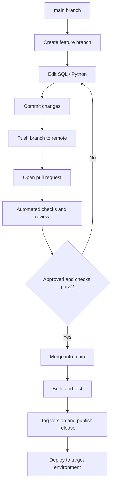
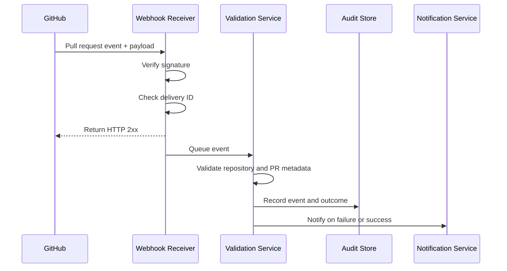
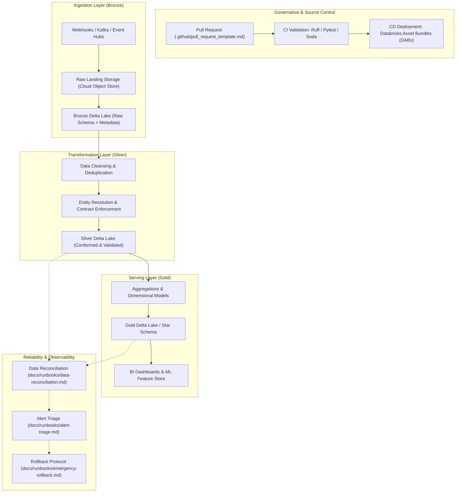

# Github-101
How Do You Really Use Github??
You have mastered the fundamentals of Git and why we use Git. I am confident that you would also know where to Git, but have you ever thought about the different MOCs (Map of Contents) of Github that you should be aware of? Be it Github as an enterprise account or In Azure Devops or in other formats? What are certain POCs (Proof of concepts) you should definitely know so that life becomes easier?

We can start here. Git stores a history of changes. GitHub and Azure Repos provide remote hosting and collaboration on top of that history.

You need to understand how engineering teams build, review, test, release, deploy, secure, and maintain software and data systems. GitHub is one part of that system, not the whole thing.

Your POC should prove that you can design an engineering workflow, automate it, control access, handle failures, and explain why the architecture works. That is the difference between knowing a tool and being able to lead a team using it.

# 1. The ecosystem you need to understand

| |
| :---: |
|  |
| <small>The key distinction: Git is the version-control engine. GitHub is a collaboration and automation platform built around Git. Azure DevOps offers a comparable ecosystem, but its repositories, pipelines, artifacts, and permissions have their own implementation and terminology.</small> |

# 2. The complete concept map

This is the landscape I would expect a future Lead Data Engineer to understand. You do not need to master every product equally. You need to understand how the pieces fit together and build at least one working example of each important capability.

## Source control

| |
| :---: |
|  |
| <small><sup>1</sup> This is a reference architecture, not a mandatory sequence. For example, a package may be published before production approval, and a release may be created before deployment or after deployment, depending on the team's release model.</small> |

# 3. Git fundamentals: the part you cannot skip


## The workflow you must be able to execute


A practical command sequence:

```
git clone <repository-url>
cd <repository-folder>

git switch -c feature/add-data-quality-checks

# Edit your files
git status
git diff

git add .
git commit -m "feat: add data quality checks"
git push -u origin feature/add-data-quality-checks
```

Then open a pull request on your hosting platform, get it reviewed, and merge it using the team's approved strategy.

Learn these commands properly:

| Command                     | Why you need it                                                  |
| --------------------------- | ---------------------------------------------------------------- |
| `git status`                | Understand your working tree                                     |
| `git diff`                  | Review changes before committing                                 |
| `git log --oneline --graph` | Inspect commit history                                           |
| `git fetch`                 | Retrieve remote history without integrating it                   |
| `git pull`                  | Fetch and integrate remote changes                               |
| `git switch -c`             | Create and switch to a branch                                    |
| `git merge`                 | Integrate another branch                                         |
| `git rebase`                | Replay commits on a new base                                     |
| `git revert`                | Undo a change through a new commit                               |
| `git reset`                 | Move a reference and potentially alter staged or working changes |
| `git cherry-pick`           | Apply a selected commit elsewhere                                |
| `git stash`                 | Temporarily save uncommitted changes                             |

The leadership-level requirement is not memorizing commands. It is knowing what state the repository is in, which operation changes that state, and how to recover without losing someone else's work.

# 4. GitHub concepts you need to know in depth

These are the concepts I would turn into individual POCs, rather than studying as isolated definitions.


## Other concepts you should cover

| Concept                | What a lead should understand                                                     |
| ---------------------- | --------------------------------------------------------------------------------- |
| Issues and Projects    | Work tracking, priorities, dependencies, milestones                               |
| Labels and milestones  | Categorizing work and grouping it into delivery targets                           |
| CODEOWNERS             | Automatically requesting review from the responsible team                         |
| Environments           | Separate deployment targets, protection rules, and environment-scoped secrets     |
| Secrets and variables  | Credentials versus non-sensitive configuration                                    |
| GitHub Apps and tokens | Application identity, permissions, token lifetimes, least privilege               |
| Dependabot             | Dependency updates and vulnerability alerts                                       |
| Code scanning          | Static analysis for security defects                                              |
| Audit logs             | Who performed an action and when, subject to platform retention and permissions   |
| Reusable workflows     | Standardized CI/CD across repositories                                            |
| Self-hosted runners    | Running jobs on infrastructure you manage, including its security implications    |
| Git LFS                | Managing large files that are unsuitable for ordinary Git history                 |
| Submodules             | Referencing another repository from a repository                                  |
| Monorepos              | Managing many components in one repository with path-aware testing and deployment |

The official [GitHub Actions workflow documentation](https://docs.github.com/en/actions/concepts/workflows-and-actions/workflows?utm_source=chatgpt.com) explains the workflow, job, runner, and step model.&#x20;

[image](https://www.google.com/s2/favicons?domain=https://docs.github.com\&sz=32)

GitHub Docs


# 5. Releases, packages, artifacts, and deployments are not the same thing

This distinction trips up many engineers because the terms are often used loosely.


One version may have multiple artifacts. A release may contain multiple packages or deployment assets. A deployment should identify the exact artifact version it uses, not merely whatever code happens to be on `main`.

For data engineering, I would extend this with data migrations and rollback. Reverting a Python commit does not automatically reverse a SQL schema change or undo data already written to a production Delta table.

## Semantic versioning

Understand the pattern `MAJOR.MINOR.PATCH`.

| Version change | Meaning                     | Example           |
| -------------- | --------------------------- | ----------------- |
| Major          | Incompatible change         | `1.4.2` → `2.0.0` |
| Minor          | Backward-compatible feature | `1.4.2` → `1.5.0` |
| Patch          | Backward-compatible fix     | `1.4.2` → `1.4.3` |

This is a convention, not an automatic guarantee. Your team must define what counts as a breaking change for a data pipeline, SQL interface, Python library, or published dataset contract.

# 6. GitHub Actions: your first serious automation POC

The fundamental hierarchy is:


A starter workflow for a Python data engineering repository could look like this:

```

name: Data Engineering CI

on:
  pull_request:
    branches: [main]
  push:
    branches: [main]

permissions:
  contents: read

jobs:
  validate:
    runs-on: ubuntu-latest

    steps:
      - name: Checkout source
        uses: actions/checkout@v4

      - name: Set up Python
        uses: actions/setup-python@v5
        with:
          python-version: "3.12"

      - name: Install dependencies
        run: |
          python -m pip install --upgrade pip
          pip install ruff pytest
          if [ -f requirements.txt ]; then
            pip install -r requirements.txt
          fi

      - name: Lint Python
        run: ruff check .

      - name: Run unit tests
        run: pytest -q

```

This is a learning example. For production, pin third-party actions to reviewed immutable commit SHAs, manage dependency versions, configure the correct Python version, and review the security of all scripts and dependencies.

To make this a proper POC:

- Add a deliberately failing test and confirm the workflow fails.
- Fix the test and confirm the workflow passes.
- Configure the workflow as a required PR check.
- Attempt a merge while the check is failing.
- Confirm that repository rules prevent the merge.
- Save the test output as an artifact.
- Add a separate deployment workflow with restricted permissions and explicit environment approval.

A crucial detail: a workflow running successfully does not, by itself, protect your branch. The repository's branch rules must require the appropriate check.

## Advanced Actions topics

Learn these after the first workflow works:

- Triggers and filters: branch filters, path filters, tags, schedules, and manual runs.
- Dependencies: `needs`, job conditions, matrices, and parallel jobs.
- Artifacts and caching: passing build outputs between jobs versus caching dependencies to speed up execution.
- Reusable workflows: shared CI/CD standards across many repositories.
- Environments: deployment protection, approvals, and environment-scoped configuration.
- OIDC: short-lived identity-based access to cloud services without storing long-lived cloud credentials.
- Concurrency: preventing competing deployments from interfering with one another.
- Security: untrusted pull-request code, token permissions, third-party action pinning, and secret exposure.
- Self-hosted runners: network access to internal systems, runner isolation, patching, and cleanup.

# 7. Webhooks, APIs, and event-driven automation

Since you mentioned webhooks specifically, build a POC that proves you understand the entire event lifecycle, not just how to configure a URL.



The production-oriented details matter:

| Mechanism                  | Purpose                                                         |
| -------------------------- | --------------------------------------------------------------- |
| Webhook event              | Notifies your service that something happened                   |
| HTTP payload               | Carries event data                                              |
| Signature verification     | Checks authenticity using the configured webhook secret         |
| Delivery ID                | Helps identify duplicate deliveries                             |
| Idempotency                | Prevents processing the same logical event twice                |
| Queue or durable store     | Protects against lost work when processing is delayed           |
| Retry and failure handling | Deals with timeouts, transient failures, and downstream outages |
| REST API                   | Fetches additional details or performs authorized operations    |
| Fine-grained permissions   | Limits what the integration can read or modify                  |

GitHub webhooks are not guaranteed to be delivered exactly once, and your receiver should not assume every event arrives in order. A robust design acknowledges the HTTP request promptly, persists the event, and processes it asynchronously when appropriate.

Build the first version with a small Python API service, such as FastAPI, and a local webhook-testing tool. Then add duplicate-event handling, persistent storage, structured logs, and retry behavior.

Azure DevOps has a similar event-integration model called Service Hooks. Microsoft documents how subscriptions connect project events to external services and actions.&#x20;

[image](https://www.google.com/s2/favicons?domain=https://learn.microsoft.com\&sz=32)

Microsoft Learn


# 8. GitHub versus Azure DevOps versus GitLab

You should understand all three ecosystems, but do not attempt to master all three simultaneously.

[GitHub official Logo PNG Vector (EPS) Free Download](https://images.openai.com/static-rsc-4/j6DnFoGR1MfnOBr9lIK962EQdYyxmY8SyJ9-28a69vOkM2BzMHwDekYl2JG6WLr8JTUKKPjN98M-z-HFImt0j5nyukd1e120mDGQLqeLKnLZ8JVrrifApGVGwSFY2cM3RpPDf7Km3KmgvbycYPvr2t5PuRLGFKmpzE2a9ikOtUk?purpose=inline)

GitHub

Best starting point for your POC portfolio.

GitHub Repositories, Pull Requests, Actions, Releases, Packages, GitHub Apps, webhooks, rulesets, and security tooling.

[Official documentation](https://docs.github.com/?utm_source=chatgpt.com)

[Creditsafe Technology](https://images.openai.com/static-rsc-4/obrracwH8DRL7ExWjl8scv5Yok5lQAC-Q-h4Hgq9VKLeWfAeuolp0N3nV-D0AWC1iBo2GfG2dcC6IGqKpV6McryLMPwDrCwfykBpe9H5gmjDtUyFRG4K4zMeWkWqBHPo9dLEx2NUOdM2idZs5u2fmc4gxJdmvqHdaV3OL4zY0wQ?purpose=inline)

Azure DevOps

Particularly relevant for enterprise delivery and Microsoft-centric environments.

Azure Repos, Azure Pipelines, Azure Artifacts, Boards, Test Plans, service connections, service hooks, and branch policies.

[Official documentation](https://learn.microsoft.com/en-us/azure/devops/?utm_source=chatgpt.com)

[Contribute through the eyes of a new GitLabber](https://images.openai.com/static-rsc-4/GVQNLBNUt4I6mhhZzvpbjWLBpysfjXEOMSZEZ9PlPOVqP0BUjqD-Nh95iT-Duyo52M2v4O6VPqfvj0Lmdqrklbl4BC8B-nV2T_Q7Luzsr5fHpvhQzF_gOQ_8XXeLvk-Zu7BGxPA3eD6YlwEvrS4FjKTiTze4KwzLg0wsrLMq5mQ?purpose=inline)

GitLab

An integrated alternative with its own repository, CI/CD, security, and release workflows.

Repositories, merge requests, GitLab CI/CD, runners, package and container registries, environments, and deployment controls.

[Official documentation](https://docs.gitlab.com/?utm_source=chatgpt.com)

| Capability         | GitHub              | Azure DevOps    | GitLab                    |
| ------------------ | ------------------- | --------------- | ------------------------- |
| Source hosting     | GitHub Repositories | Azure Repos     | GitLab repositories       |
| Code review        | Pull requests       | Pull requests   | Merge requests            |
| CI/CD              | GitHub Actions      | Azure Pipelines | GitLab CI/CD              |
| Work tracking      | Issues and Projects | Azure Boards    | Issues and planning tools |
| Package registry   | GitHub Packages     | Azure Artifacts | Package Registry          |
| Event integrations | Webhooks and Apps   | Service Hooks   | Webhooks and integrations |

One important correction to the terminology in your question: Azure DevOps does not simply use GitHub. They are separate platforms that can integrate. Azure Pipelines can build GitHub-hosted repositories, and GitHub Actions can deploy to Azure services.&#x20;

[image](https://www.google.com/s2/favicons?domain=https://github.com\&sz=32)

GitHub

+1


Learn the underlying concepts first, then learn the platform-specific implementation.

# 9. The POC portfolio I would build in your position

Do not create 20 disconnected demos. Build one realistic data engineering platform and progressively add engineering capabilities to it.

Use a fictional healthcare analytics pipeline with Python, SQL, PySpark, Delta Lake, and Databricks-style deployment scripts. It is close enough to real data engineering work to be credible, but it does not require access to production data or infrastructure.

Select any POC to see what it should demonstrate and how you can prove it works.

## POC tracker

0 / 10 complete

Git and repository workflowFoundation1 weekPull request governanceFoundation1 weekAutomated CI pipelineCore1 to 2 weeksRun Python linting, SQL validation, unit tests, data-quality tests, and test reporting on every PR.Definition of doneSuccessful and intentionally failing runs, required status checks, and retained test artifacts.Packages and releasesCore1 to 2 weeksEnvironment-aware CDAdvanced2 weeksWebhook-driven integrationAdvanced1 to 2 weeksSecurity and identityAdvanced2 weeksMulti-repository engineering platformLead-level2 to 3 weeksProduction operationsLead-level2 weeksAzure DevOps implementationLead-level2 to 3 weeksCopy complete POC plan

These time estimates are rough effort estimates, not deadlines. Start with the first three and build working examples before moving to the next layer.

## 10. Your two-year roadmap to Lead Data Engineer

You have roughly two years until the five-year experience mark. I would use that time to build both technical depth and evidence that you can own engineering outcomes.

### Phase 1: Months 1 to 3

Fundamentals

- Git internals, branching, merge conflicts, tags, and recovery.
- GitHub repositories, pull requests, reviews, and branch rules.
- One CI workflow with automated tests.
- Basic Linux shell, HTTP, JSON, YAML, and REST APIs.

Exit criterion: You can explain and demonstrate a complete reviewed code change from branch creation through merge.

### Phase 2: Months 4 to 6

Delivery

- Packages, artifacts, semantic versioning, and releases.
- DEV/UAT/PROD deployment workflows.
- Environment approvals, secrets, and rollback.
- SQL, Python, and data-quality validation in CI.

Exit criterion: You can release a tested data pipeline version and promote it safely between environments.

### Phase 3: Months 7 to 12

Platform engineering

- Webhooks, API integrations, reusable workflows, and multi-repository architecture.
- Cloud identity, OIDC, least privilege, dependency security, and auditability.
- Databricks asset deployment, infrastructure as code, and environment drift.
- Azure Pipelines integration and platform comparison.

Exit criterion: Another engineer can use your shared pipeline framework without copying and independently maintaining all its logic.

### Phase 4: Months 13 to 18

Reliability

- Failure recovery, incident response, monitoring, and data reconciliation.
- Deployment safety, backward-compatible schema evolution, and idempotent jobs.
- Performance and cloud-cost controls.
- Technical design documents, tradeoff analysis, and architecture reviews.

Exit criterion: You can explain how the platform behaves during failures, not just when everything works.

### Phase 5: Months 19 to 24

Leadership evidence

- Standardize engineering practices across multiple repositories.
- Mentor another engineer through a PR and release workflow.
- Lead a design review and defend architectural tradeoffs.
- Measure deployment failure rate, lead time, recovery time, and test effectiveness.
- Document a complete platform architecture and operational runbook.

Exit criterion: You can demonstrate ownership of a production-oriented engineering system and show how you improved the team's delivery process.

## 11. What will actually make you lead-ready?

Be careful about a common trap: collecting tools and certificates can create the appearance of progress without proving that you can lead engineering work.

For your target role, I would prioritize these five capabilities.


## 12. Your first POC should be this

Build a Data Engineering CI/CD Reference Platform with one GitHub repository containing:

- `src/`: Python data transformation and validation logic.
- `sql/`: SQL transformations and schema migrations.
- `tests/`: unit tests and data-quality tests.
- `configs/`: environment-specific, non-secret configuration.
- `deploy/`: deployment scripts.
- `.github/workflows/`: CI and deployment workflows.
- `docs/`: architecture, setup instructions, release process, and recovery runbook.

Then add the features in this order:

1. Branch-based development and reviewed pull requests.
2. Automated linting and tests.
3. Required PR checks and ownership rules.
4. Versioned package or deployment artifact.
5. Tagged release with release notes.
6. DEV/UAT/PROD deployment controls.
7. Secure cloud authentication and environment secrets.
8. Webhook-driven notifications and audit logging.
9. Failure injection, rollback, and incident documentation.
10. Reusable workflows for a second repository.

The second repository is important. A single repository with a successful pipeline proves that you can configure CI/CD. Two or more repositories consuming a shared engineering standard start to demonstrate that you can design a platform for a team.

My recommendation is to use GitHub as your learning environment, Python and SQL as your workload, and Azure/Databricks as your deployment target. Later, reproduce the essential workflow in Azure DevOps. That gives you both transferable knowledge and a credible portfolio for enterprise data engineering roles.


---

# 13. Lead Data Engineering Reference Platform: Operational Architecture

To operate at the lead level, engineering rigor must extend beyond simple pipelines into platform governance, automated quality gates, verifiable data contracts, and enterprise-grade operational resilience. This repository serves as the definitive reference implementation for modern Lakehouse engineering on GitHub and Databricks.

### Core Objectives
1. **Zero-Trust Governance**: Fine-grained access control, automated secret rotation, and immutable audit trails.
2. **Shift-Left Quality**: Contract-driven development, automated schema evolution guards, and pre-merge validation.
3. **Reproducible Deployments**: Databricks Asset Bundles (DABs), semantic versioning, and deterministic multi-environment promotion.
4. **Resilient Operations**: Automated runbooks, idempotent recovery workflows, and cross-stage data reconciliation.

### Platform Architecture & Document Directory

```
.
├── .github/
│   ├── issue_templates/bug_report.md       # Defect reporting with pipeline runtime context
│   └── pull_request_template.md            # Enforces code review, testing & schema impact analysis
├── CONTRIBUTING.md                          # Contribution guidelines, commit & branch standards
├── SECURITY.md                              # Vulnerability reporting protocol & CVSS triage SLA
└── docs/
    ├── adr/                                # Architectural Decision Records
    │   ├── 001-orchestration-choice.md     # GitHub Actions vs Airflow vs Step Functions
    │   ├── 002-format-choice.md            # Delta Lake vs Apache Iceberg vs Apache Hudi
    │   ├── 003-compute-engine.md           # Databricks Photon vs Serverless vs EMR
    │   └── 004-secret-management.md        # Azure Key Vault / AWS Secrets Manager & OIDC
    ├── architecture/                       # System & Data Architecture
    │   ├── data-contracts.md               # JSON Schema / PyDantic / Great Expectations contracts
    │   ├── state-management.md             # Delta ACID transactions, log commits & time travel
    │   └── system-overview.md              # Medallion architecture (Bronze -> Silver -> Gold)
    ├── cicd/                               # Continuous Integration & Delivery
    │   ├── caching-strategy.md             # Pip, wheel, and compilation caching optimization
    │   ├── environment-promotion.md        # Dev -> Staging -> Prod gates & approvals
    │   ├── oidc-integration.md             # Keyless authentication with cloud providers
    │   ├── pipeline-overview.md            # End-to-end CI/CD sequence and quality stages
    │   ├── release-strategy.md             # Semantic versioning, changelog & artifact tagging
    │   ├── reusable-workflows.md           # Modular shared GitHub Actions workflows
    │   └── self-hosted-runners.md          # Hybrid VPC runner isolation and security
    ├── devex/                              # Developer Experience
    │   ├── dependency-management.md        # UV / Poetry lockfiles and supply chain integrity
    │   ├── linting-and-formatting.md       # Ruff, Black, and SQLFluff pre-commit hooks
    │   └── local-environment.md            # Devcontainers and Spark local testing harnesses
    ├── infrastructure/                     # Infrastructure as Code (IaC) & Cloud
    │   ├── cluster-policies.md             # Compute guardrails, auto-termination & tagging
    │   ├── cost-optimization.md            # Spot instances, graviton nodes & storage tiers
    │   ├── databricks-asset-bundles.md     # DABs configuration, bundle deployment & CI sync
    │   ├── iac-overview.md                 # Terraform modules for cloud storage & compute
    │   ├── identity-and-access.md          # Unity Catalog service principals, RBAC & ABAC
    │   └── network-topology.md             # Private Link, VPC peering & transit gateways
    ├── integrations/                       # Webhooks & External Services
    │   ├── event-idempotency.md            # Deduplication tokens and transactional sinks
    │   ├── external-api-auth.md            # mTLS, OAuth2 token exchange & rate limits
    │   └── webhook-architecture.md         # Event-driven triggers and dead-letter queues
    ├── runbooks/                           # Operational Runbooks & SRE
    │   ├── alert-triage.md                 # Alert categorization, runbook links & noise reduction
    │   ├── capacity-planning.md            # Shuffling skew, storage growth & compute forecasting
    │   ├── data-reconciliation.md          # Multi-table checksums, row-count & drift repair
    │   ├── emergency-rollback.md           # Atomic Delta restore, pipeline freeze & failover
    │   ├── incident-response.md            # Severity matrix, war rooms & post-incident review
    │   └── standard-deployment.md          # Blue/green deployment & canary verification steps
    ├── security/                           # Platform Security
    │   ├── secret-rotation.md              # Automated token cycling and zero-downtime rotation
    │   └── vulnerability-scanning.md       # Trivy, Dependabot, and container vulnerability gates
    └── testing/                            # Testing & Data Quality
        ├── data-quality-framework.md       # Great Expectations, Soda Core & dbt assertions
        ├── integration-testing.md          # End-to-end integration tests on ephemeral clusters
        ├── mock-data-generation.md         # Faker, dbldatagen & synthetic data factories
        ├── schema-evolution.md             # Schema enforcement, mergeSchema & deprecation policy
        ├── test-data-management.md         # Golden datasets, anonymization & state teardown
        └── unit-testing-guide.md           # Pure PySpark function testing with pytest
```

### Platform Architecture & Data Flow Diagram



### Role-Based Navigation Matrix

To extract the highest value from this repository, review documents according to your organizational focus:

| Engineering Role | Recommended Document Path | Primary Deliverable |
| :--- | :--- | :--- |
| **Lead Platform Architect** | `docs/architecture/*`, `docs/adr/*`, `docs/infrastructure/*` | Multi-cloud architecture, IaC blueprints, compute cost controls |
| **Senior Data Engineer** | `docs/testing/*`, `docs/devex/*`, `docs/architecture/data-contracts.md` | Pure Spark pipelines, automated testing harnesses, contract enforcement |
| **DevOps / CI/CD Engineer** | `docs/cicd/*`, `docs/infrastructure/databricks-asset-bundles.md` | GitHub Actions reusable workflows, OIDC security, runner topologies |
| **Data Reliability Engineer (SRE)** | `docs/runbooks/*`, `docs/integrations/*` | Incident triage, MTTR reduction, zero-data-loss rollback runbooks |
| **Data Governance & Security Officer** | `SECURITY.md`, `docs/security/*`, `docs/infrastructure/identity-and-access.md` | Principle of least privilege, audit logging, vulnerability remediation |

### Production Readiness & Platform Health Targets

The platform implements strict Service Level Indicators (SLIs) and Objectives (SLOs):

* **Deployment Frequency**: ≥ 5 automated releases per week across micro-pipelines.
* **Lead Time for Changes**: < 30 minutes from approved PR to production staging.
* **Change Failure Rate**: < 1.0% of deployments requiring emergency rollback.
* **Mean Time to Recovery (MTTR)**: < 15 minutes utilizing Delta Lake time travel and automated bundle rollback.
* **Data Freshness SLO**: 99.9% of data landed in Gold within 60 minutes of upstream emission.
* **Data Contract Compliance**: 100% enforcement; zero schema drift without explicit semantic version increment.

For contribution standards, proceed to [CONTRIBUTING.md](CONTRIBUTING.md). For vulnerability reporting, see [SECURITY.md](SECURITY.md).
