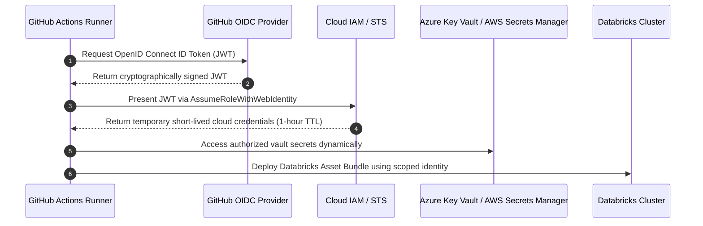

# ADR 004: Secrets Management and Keyless Authentication

## Status
Accepted

## Context
Data engineering pipelines must securely interact with cloud providers, storage buckets, external REST APIs, and database sinks without exposing long-lived credentials in code repositories or environment variables.

## Evaluated Secret Management Approaches

1. **Static GitHub Repository Secrets & Service Principal Keys**
   * *Cons*: High security risk; credentials do not expire; manual rotation burden; vulnerability to repository credential leaks.
2. **Databricks Standard Secret Scopes (CLI-managed)**
   * *Cons*: Secrets stored in Databricks control plane; lacks enterprise audit integration; difficult to synchronize across environments.
3. **Cloud-Native Vault + OIDC Workload Identity Federation (Selected)**
   * *Pros*: Zero static secrets in GitHub; temporary tokens with 60-minute TTL; backed by Azure Key Vault / AWS Secrets Manager; full enterprise audit logs.

## Authentication Architecture Diagram

