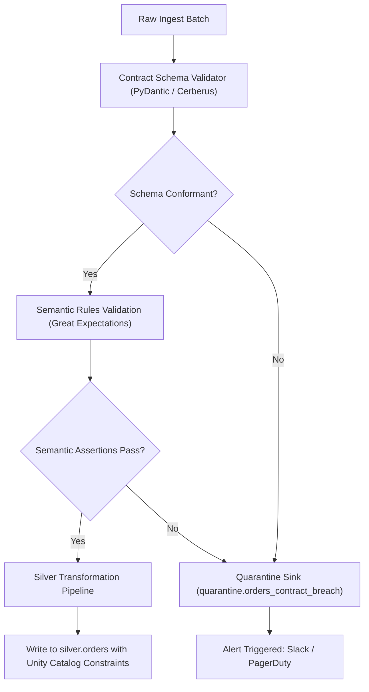

# Data Contracts Specification

Data contracts are formal, versioned, and machine-enforceable agreements between data producers, transformation pipelines, and consuming applications.

## 1. Motivation
Without explicit data contracts:
* Upstream application engineers make breaking schema changes without notice.
* Downstream data pipelines fail silently or propagate bad data into BI dashboards.
* Triage time is spent finger-pointing rather than resolving root causes.

Our platform treats data contracts as code: versioned in Git, tested in CI, and enforced at pipeline runtime.

## 2. Data Contract Schema Definition (YAML Standard)

Every ingested entity must maintain a contract definition under `contracts/`:

```yaml
version: "1.2.0"
dataset: "orders"
domain: "ecommerce"
owner: "checkout-platform-team"
sla:
  freshness_minutes: 30
  completeness_percent: 99.95

schema:
  - name: "order_id"
    type: "string"
    nullable: false
    description: "UUID v4 primary key"
    rules:
      - pattern: "^[0-9a-f]{8}-[0-9a-f]{4}-4[0-9a-f]{3}-[89ab][0-9a-f]{3}-[0-9a-f]{12}$"
  - name: "customer_id"
    type: "string"
    nullable: false
    description: "Foreign key referencing customers"
  - name: "order_status"
    type: "string"
    nullable: false
    rules:
      - allowed_values: ["PENDING", "CONFIRMED", "PROCESSING", "SHIPPED", "DELIVERED", "CANCELLED"]
  - name: "total_amount"
    type: "decimal(18,2)"
    nullable: false
    rules:
      - min_value: 0.00
      - max_value: 1000000.00
  - name: "created_at"
    type: "timestamp"
    nullable: false
```

## 3. Enforcement Architecture & Flow



## 4. Runtime Validation Implementation in PySpark

Contract enforcement is implemented as a vectorized filter to preserve Photon query execution speeds:

```python
from pyspark.sql import DataFrame
import pyspark.sql.functions as F

def enforce_order_contract(df: DataFrame) -> tuple[DataFrame, DataFrame]:
    valid_conditions = (
        F.col("order_id").isNotNull() &
        F.col("customer_id").isNotNull() &
        F.col("order_status").isin(["PENDING", "CONFIRMED", "PROCESSING", "SHIPPED", "DELIVERED", "CANCELLED"]) &
        (F.col("total_amount") >= 0.00) &
        (F.col("total_amount") <= 1000000.00) &
        F.col("created_at").isNotNull()
    )
    
    valid_df = df.filter(valid_conditions)
    invalid_df = df.filter(~valid_conditions).withColumn(
        "rejection_reason",
        F.when(F.col("order_id").isNull(), "NULL_ORDER_ID")
        .when(~F.col("order_status").isin(["PENDING", "CONFIRMED", "SHIPPED"]), "INVALID_STATUS")
        .otherwise("OUT_OF_BOUNDS")
    )
    return valid_df, invalid_df
```

## 5. Contract Evolution, Deprecation & Breach Protocol

### Contract Versioning
* **PATCH (1.2.0 -> 1.2.1)**: Description changes, documentation, relaxations that do not affect data readers.
* **MINOR (1.2.0 -> 1.3.0)**: Adding a new nullable field or relaxing constraints. Backwards-compatible.
* **MAJOR (1.2.0 -> 2.0.0)**: Removing fields, renaming columns, or tightening constraints. **Requires 30-day deprecation notice.**

### Contract Breach Protocol
1. Downstream pipeline routes invalid records to quarantine table.
2. Alert fires to Producer oncall (`checkout-platform-team`).
3. Severity evaluated via [Alert Triage Runbook](../runbooks/alert-triage.md).
4. If breach > 5% of total batch, pipeline execution pauses to prevent data contamination.
