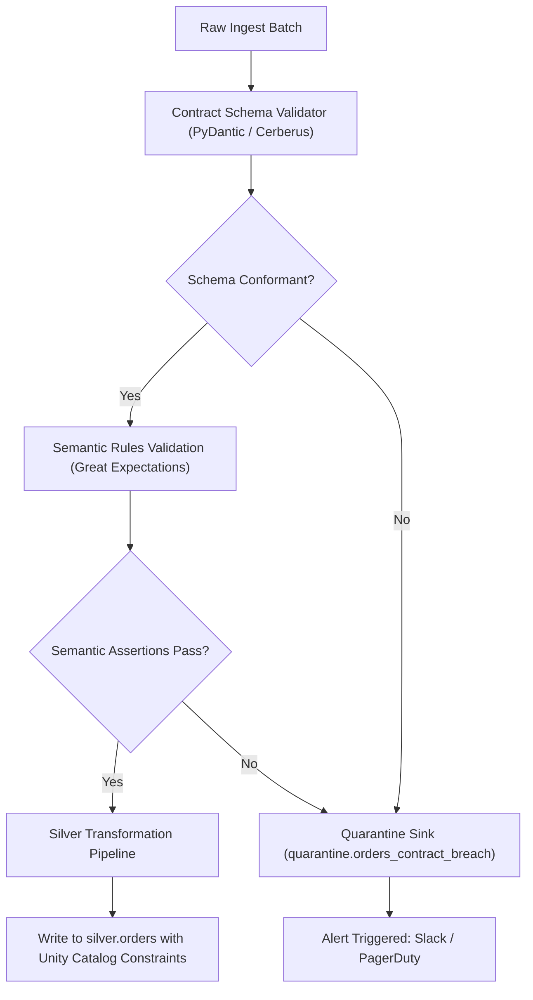

# Data Contracts Specification

Data contracts are formal, versioned, and machine-enforceable agreements between data producers, transformation pipelines, and consuming applications.

## 1. Motivation
Without explicit data contracts:
* Upstream application engineers make breaking schema changes without notice.
* Downstream data pipelines fail silently or propagate bad data into BI dashboards.
* Triage time is spent finger-pointing rather than resolving root causes.

Our platform treats data contracts as code: versioned in Git, tested in CI, and enforced at pipeline runtime.

## 2. Data Contract Schema Definition (YAML Standard)

Every ingested entity must maintain a contract definition under `contracts/`:

```yaml
version: "1.2.0"
dataset: "orders"
domain: "ecommerce"
owner: "checkout-platform-team"
sla:
  freshness_minutes: 30
  completeness_percent: 99.95

schema:
  - name: "order_id"
    type: "string"
    nullable: false
    description: "UUID v4 primary key"
    rules:
      - pattern: "^[0-9a-f]{8}-[0-9a-f]{4}-4[0-9a-f]{3}-[89ab][0-9a-f]{3}-[0-9a-f]{12}$"
  - name: "customer_id"
    type: "string"
    nullable: false
    description: "Foreign key referencing customers"
  - name: "order_status"
    type: "string"
    nullable: false
    rules:
      - allowed_values: ["PENDING", "CONFIRMED", "PROCESSING", "SHIPPED", "DELIVERED", "CANCELLED"]
  - name: "total_amount"
    type: "decimal(18,2)"
    nullable: false
    rules:
      - min_value: 0.00
      - max_value: 1000000.00
  - name: "created_at"
    type: "timestamp"
    nullable: false
```

## 3. Enforcement Architecture & Flow


