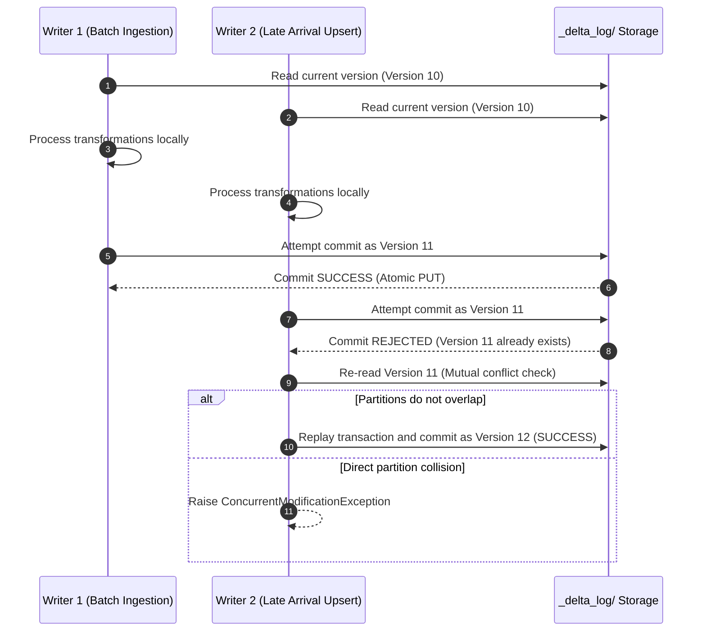

# State Management in Delta Lake

State management in the Lakehouse provides ACID transaction guarantees, concurrency control, and time travel capabilities over raw cloud object storage.

## 1. Foundations of Lakehouse State
Unlike traditional data lakes that suffer from partial writes and dirty reads, our platform utilizes Delta Lake to guarantee:
* **Atomicity**: Writes either succeed in their entirety or leave the table unmodified.
* **Consistency**: Readers always observe a coherent snapshot without seeing in-flight modifications.
* **Isolation**: Concurrent writers are managed through Optimistic Concurrency Control (OCC).
* **Durability**: Committed transactions persist permanently in cloud storage.

## 2. The Delta Transaction Log (`_delta_log`)

All table state is recorded in an ordered sequence of JSON commit files inside the `_delta_log/` directory:

```text
_delta_log/
├── 00000000000000000000.json      # Initial commit: schema & initial parquet files
├── 00000000000000000001.json      # Append transaction: adds part-0001.parquet
├── 00000000000000000002.json      # Upsert transaction: removes old parts, adds new parts
├── ...
└── 00000000000000000010.checkpoint.parquet # Compacted checkpoint every 10 commits
```

### Commit Actions
A commit file contains discrete action entries:
* `add`: Registers a new Parquet data file with partition values and statistical metadata (min/max values, null counts).
* `remove`: Marks a previously active Parquet file as logically deleted.
* `metaData`: Updates table schema, partitioning columns, or configuration properties.
* `protocol`: Enforces reader/writer protocol version constraints.

## 3. Optimistic Concurrency Control (OCC) Workflow

Delta Lake handles concurrent writes without global distributed locks using optimistic concurrency control:



## 4. Time Travel, Auditing & Restore Mechanics

Because historical Parquet files are preserved until explicitly pruned by `VACUUM`, any historical state can be queried or restored:

### Querying Historical State
```python
# Query table state as of version 4
df_v4 = spark.read.format("delta").option("versionAsOf", 4).table("silver.orders")

# Query table state as of specific timestamp
df_ts = spark.read.format("delta").option("timestampAsOf", "2026-10-24 08:00:00").table("silver.orders")
```

### Point-in-Time Table Restoration
If bad data is merged into production, the table can be rolled back instantly without recomputing historical data:
```sql
-- Immediate atomic rollback in SQL
RESTORE TABLE silver.orders TO VERSION AS OF 15;
```

## 5. Storage Maintenance: Compaction, Vacuuming & Liquid Clustering

To maintain high query performance and manage storage costs, automated maintenance jobs run weekly:

### Compaction & Z-Ordering
```sql
OPTIMIZE silver.orders
WHERE order_date >= current_date() - INTERVAL 30 DAYS
ZORDER BY (customer_id, order_status);
```

### Vacuum Safety Protocols
```sql
-- Retain 168 hours (7 days) of history for audit and emergency rollback
SET spark.databricks.delta.vacuum.parallelDelete.enabled = true;
VACUUM silver.orders RETAIN 168 HOURS;
```

> [!CAUTION]
> Never set retention to 0 hours in production. Vacuuming active files will cause `FileNotFoundException` in running queries.
