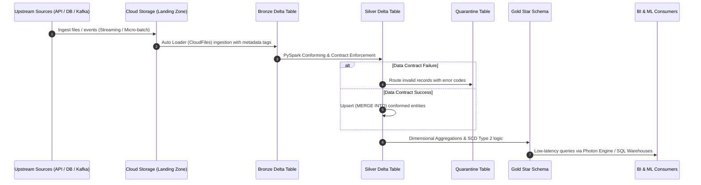

# System Architecture Overview

The Lead Data Engineering Reference Platform implements an enterprise-grade Medallion Lakehouse Architecture running on cloud object storage (ADLS Gen2 / AWS S3) and Databricks.

## 1. Architectural Philosophy
Our data architecture adheres to five foundational tenets:
* **Decoupled Compute and Storage**: Storage is persistent, immutable, and decoupled from ephemeral compute clusters.
* **Medallion Data Progression**: Data transitions through Bronze (Raw/Ingest), Silver (Conformed/Cleaned), and Gold (Curated/Aggregated) layers.
* **ACID Guarantees Everywhere**: Delta Lake format ensures transactions are atomic, consistent, isolated, and durable.
* **Shift-Left Contract Validation**: Schema rules and quality constraints are verified at ingestion boundaries.
* **Unified Governance**: Catalog, schema, and column-level access controls managed via Unity Catalog.

## 2. Medallion Layer Specifications

### Bronze Layer (Raw Landing & Append-Only)
* **Purpose**: Ingest raw source data with fidelity preservation.
* **Characteristics**: Append-only Delta tables; permissive schemas.
* **Standard Metadata Columns**:
  * `_ingest_timestamp`: UTC timestamp when the record entered the lakehouse.
  * `_source_file`: Origin file name / partition path.
  * `_batch_id`: Orchestrator run identifier for traceability.
  * `_raw_payload`: Complete unparsed JSON/string payload in case of schema parsing failure.

### Silver Layer (Cleansed, Validated & Conformed)
* **Purpose**: Provide enterprise-wide single source of truth for business entities.
* **Transformations**:
  * Null handling, type casting, standardization (e.g. ISO-8601 timestamps, ISO-3166 country codes).
  * Deduplication using deterministic business keys and event watermarking.
  * Data contract verification against `docs/architecture/data-contracts.md`.
  * Malformed records routed to `quarantine.rejected_records`.

### Gold Layer (Curated Dimensional Models & Feature Stores)
* **Purpose**: High-performance analytical consumption for BI dashboards, reporting, and ML feature stores.
* **Structure**: Dimensional models (Kimball Star Schema: Fact and Dimension tables) and aggregated rollups.
* **Optimization**: Z-ORDER indexing or Liquid Clustering on high-cardinality filter and join columns.

## 3. End-to-End Data Movement Sequence

