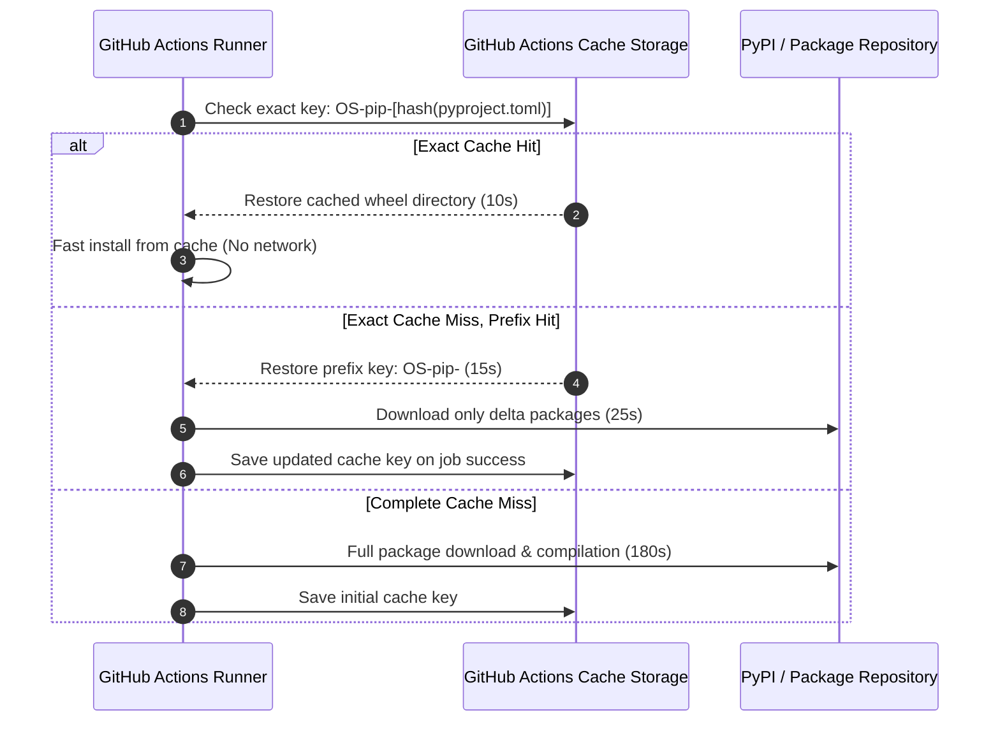

# CI/CD Caching Strategy

Optimizing pipeline build and test durations is vital for maintaining high engineering velocity. This document outlines our caching architecture for Python dependencies, PySpark wheels, and pre-commit environments.

## 1. Caching Objectives
* Reduce PR validation feedback loop to < 3 minutes.
* Eliminate redundant compilation of C-extension wheels (e.g. `numpy`, `pyarrow`, `cryptography`).
* Respect GitHub Actions 10GB per repository cache quota through proactive eviction.

## 2. Multi-Layer Caching Architecture

We cache at three distinct layers:

1. **Pre-commit Cache**: Caches linters and formatters (`ruff`, `black`, `sqlfluff`).
2. **Pip / UV Dependency Cache**: Caches downloaded Python wheels matching package hashes.
3. **Databricks CLI Cache**: Caches the standalone Databricks CLI executable.

```yaml
- name: Cache Python Virtualenv
  uses: actions/cache@v4
  with:
    path: ~/.cache/pip
    key: ${{ runner.os }}-pip-${{ hashFiles('**/pyproject.toml', '**/requirements*.txt') }}
    restore-keys: |
      ${{ runner.os }}-pip-
```

## 3. Cache Key Resolution & Restoration Flow



## 4. Cache Invalidation and Poisoning Prevention

### Deterministic Hash Invalidation
Cache keys incorporate a cryptographic SHA-256 hash of lockfiles. Modifying a single dependency version in `pyproject.toml` automatically generates a new key, preventing stale dependencies:
```yaml
key: ${{ runner.os }}-venv-${{ hashFiles('poetry.lock') }}
```

### Poisoning Mitigation
To protect against supply chain poisoning:
* Cache writes are restricted to the default branch (`main`).
* Pull requests from forks cannot read or write to internal repository caches.

## 5. Performance Benchmarks

| Pipeline Stage | Cold Run (No Cache) | Warm Run (Cache Hit) | Velocity Gain |
| :--- | :--- | :--- | :--- |
| **Dependency Installation** | 3m 45s | 18s | **12.5x faster** |
| **Pre-commit Linting** | 1m 20s | 9s | **8.8x faster** |
| **PySpark Unit Tests** | 2m 10s | 45s | **2.8x faster** |
| **Total PR CI Feedback** | **7m 15s** | **1m 12s** | **6.0x overall improvement** |
