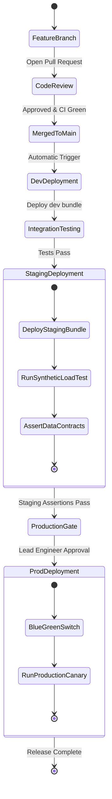

# Environment Promotion Strategy

Enterprise data engineering requires deterministic promotion of pipeline code and configurations through segregated cloud environments to ensure data integrity and prevent production disruptions.

## 1. Environment Segregation Matrix
Our platform maintains three physically isolated cloud environments:

| Environment | Purpose | Target Catalog | Access Policy |
| :--- | :--- | :--- | :--- |
| **Development (`dev`)** | Feature development and unit validation | `dev_lakehouse` | Data Engineers (Read/Write) |
| **Staging (`staging`)** | Pre-production integration & load testing | `staging_lakehouse` | CI/CD Service Principal only |
| **Production (`prod`)** | Live business-critical serving & BI | `prod_lakehouse` | Automated CD only; Zero human write |

## 2. Promotion Gates and Approvals

Promotion between environments is controlled by GitHub Environment Protection Rules:

```
[Feature Branch] 
      │ 
      ▼ (Automated PR Checks)
[Main Branch] 
      │
      ▼ (Automatic Deploy)
[Development Environment]
      │
      ▼ (Automated Integration Tests Pass)
[Staging Environment]
      │
      ▼ (Manual Gate: Lead Data Engineer + Automated Canary Pass)
[Production Environment]
```

### Gate Requirements for Production
1. **Required Approvers**: At least one designated Lead Data Engineer must approve the GitHub Environment deployment.
2. **Wait Timer**: 5-minute stabilization pause before promoting to production.
3. **Branch Protection**: Production deployments are strictly restricted to the `main` branch or signed `release/*` tags.

## 3. Environment Promotion State Diagram



## 4. Multi-Environment Bundle Configuration (`databricks.yml`)

The platform uses Databricks Asset Bundles to declare target-specific configurations cleanly:

```yaml
bundle:
  name: lead-data-pipeline

targets:
  dev:
    mode: development
    default: true
    workspace:
      host: https://adb-dev.azuredatabricks.net
    variables:
      catalog_name: dev_lakehouse

  staging:
    mode: production
    workspace:
      host: https://adb-staging.azuredatabricks.net
    variables:
      catalog_name: staging_lakehouse

  prod:
    mode: production
    workspace:
      host: https://adb-prod.azuredatabricks.net
    variables:
      catalog_name: prod_lakehouse
```
