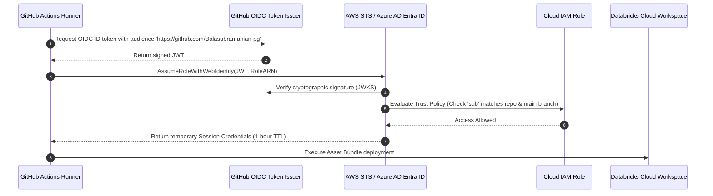

# Cloud OIDC Integration Guide

OpenID Connect (OIDC) allows GitHub Actions workflows to authenticate directly with cloud providers (AWS, Azure, GCP) using short-lived cryptographically signed tokens, completely eliminating long-lived static secrets.

## 1. Why OIDC is Mandatory
* **Zero Secret Exposure**: No AWS Access Keys or Azure Client Secrets stored in GitHub repository settings.
* **Automatic Expiration**: Tokens expire automatically after 60 minutes.
* **Granular Least Privilege**: Cloud roles restrict access based on specific GitHub claims (e.g. branch name, environment, tag).

## 2. Token Exchange Protocol

The OIDC exchange follows a three-step cryptographic validation:

```
1. GitHub Runner requests OIDC Token from GitHub Token Service.
2. GitHub issues a signed JSON Web Token (JWT) containing repository metadata.
3. Runner presents JWT to Cloud STS (AssumeRoleWithWebIdentity).
4. Cloud STS validates GitHub's public certificate and issues temporary credentials.
```

### Claims in the GitHub OIDC JWT:
```json
{
  "iss": "https://token.actions.githubusercontent.com",
  "sub": "repo:Balasubramanian-pg/Github-101:ref:refs/heads/main",
  "aud": "https://github.com/Balasubramanian-pg",
  "repository": "Balasubramanian-pg/Github-101",
  "repository_owner": "Balasubramanian-pg",
  "ref": "refs/heads/main",
  "environment": "prod"
}
```

## 3. OIDC Authentication Flow Diagram



## 4. Implementation Example: GitHub Actions & AWS / Azure

### GitHub Actions Workflow Permissions
```yaml
permissions:
  id-token: write   # Required to request GitHub OIDC JWT
  contents: read    # Required to checkout code
```

### AWS Implementation
```yaml
- name: Configure AWS Credentials via OIDC
  uses: aws-actions/configure-aws-credentials@v4
  with:
    role-to-assume: arn:aws:iam::123456789012:role/github-actions-data-platform
    aws-region: us-east-1
    audience: https://github.com/Balasubramanian-pg
```

### Azure Implementation
```yaml
- name: Azure Login via OIDC
  uses: azure/login@v2
  with:
    client-id: ${{ secrets.AZURE_CLIENT_ID }}
    tenant-id: ${{ secrets.AZURE_TENANT_ID }}
    subscription-id: ${{ secrets.AZURE_SUBSCRIPTION_ID }}
```

## 5. Security Guardrails & Troubleshooting

### Strict Subject Claim Filtering
Never configure wildcard trust policies (`repo:Balasubramanian-pg/*:*`). Always bind permissions to specific repositories and environments:
```json
{
  "StringEquals": {
    "token.actions.githubusercontent.com:sub": "repo:Balasubramanian-pg/Github-101:environment:prod"
  }
}
```

### Troubleshooting Common Handshake Failures
* **Error `InvalidIdentityToken`**: Verify the audience claim matches between GitHub workflow and Cloud IAM trust policy.
* **Error `AccessDenied`**: Confirm the branch or environment matches the `sub` claim regex.
