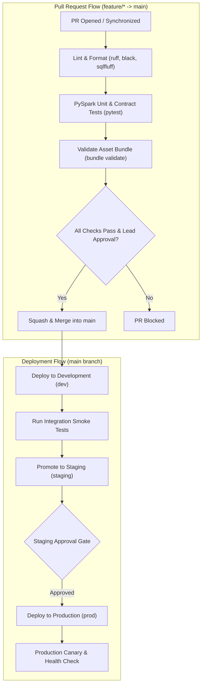

# Continuous Integration & Delivery Pipeline Overview

The Lead Data Engineering Platform treats data pipelines as mission-critical software. Every code change, schema update, and configuration tweak undergoes automated verification before reaching cloud environments.

## 1. CI/CD Principles
* **Shift-Left Quality**: Catch syntax errors, type mismatches, and data contract violations before cloud compute is triggered.
* **Hermetic Environments**: Ephemeral test execution with zero reliance on manual cluster setup.
* **Deterministic Deployment**: Deployments driven exclusively by declarative Databricks Asset Bundles (DABs).
* **Automated Auditability**: Every deployment is linked cryptographically to a specific commit SHA and pull request approval.

## 2. Pipeline Execution Stages

The delivery pipeline consists of five sequential stages:

1. **Stage 1: Static Analysis & Linting**
   * Code formatting check via `black --check`.
   * Fast linting and import sorting via `ruff`.
   * Static SQL dialect verification via `sqlfluff`.
2. **Stage 2: Unit & Contract Testing**
   * Isolated PySpark transformation tests via `pytest`.
   * Schema contract assertions via Great Expectations / Soda Core.
   * Target execution duration: < 2 minutes.
3. **Stage 3: Bundle Compilation & Validation**
   * Databricks Asset Bundle syntax and variable resolution check via `databricks bundle validate`.
   * Dry-run deployment generation.
4. **Stage 4: Automated Deployment**
   * Keyless OIDC authentication to target cloud account.
   * Bundle deployment via `databricks bundle deploy -t [dev|staging|prod]`.
5. **Stage 5: Smoke Testing & Telemetry**
   * Ephemeral test job run verification on Serverless compute.
   * Notification emitted to Slack / PagerDuty upon success or failure.

## 3. End-to-End Workflow Architecture Diagram

