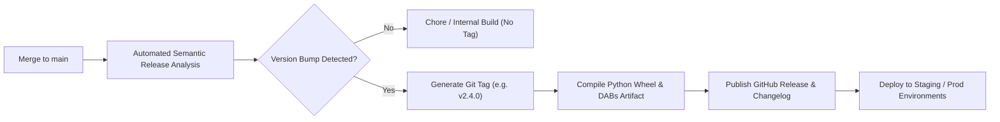

# Release Strategy & Versioning Architecture

This document formalizes our release lifecycle, semantic versioning rules, artifact generation, and deployment tagging protocols for data platform pipelines.

## 1. Guiding Principles
* **Semantic Versioning (SemVer 2.0.0)**: Releases follow `vMAJOR.MINOR.PATCH` notation.
* **Immutable Artifacts**: Once published, Python wheels, Docker images, and Databricks Asset Bundles cannot be modified or re-tagged.
* **Traceable Lineage**: Every release artifact maps directly to a signed git tag and commit SHA.

## 2. Version Increment Rules for Data Systems

| Version Component | Trigger Criteria | Examples |
| :--- | :--- | :--- |
| **MAJOR** (`v2.0.0`) | Breaking changes to schemas, dropped columns, major table restructuring | Dropping `customer_id`, changing partition key |
| **MINOR** (`v1.4.0`) | Additive backward-compatible features | Adding new nullable column, new pipeline |
| **PATCH** (`v1.3.2`) | Bug fixes, performance optimizations, runbook updates | Vectorizing filter, fixing null pointer exception |

## 3. Release Lifecycle & Git Tagging Flow



## 4. Automated Changelog Generation

Using Conventional Commits, release notes are automatically drafted and grouped:

```markdown
## What's Changed in v2.4.0

### Features (Minor)
* feat(spark): implement vectorized silver ingestion for orders (@Balasubramanian-pg)
* feat(contracts): add data contract assertions for shipping address (@Balasubramanian-pg)

### Fixes (Patch)
* fix(delta): resolve concurrent modification exception on upsert (@Balasubramanian-pg)

### Infrastructure & Operations
* infra(dabs): upgrade cluster runtime to Databricks Runtime 14.3 LTS
```
