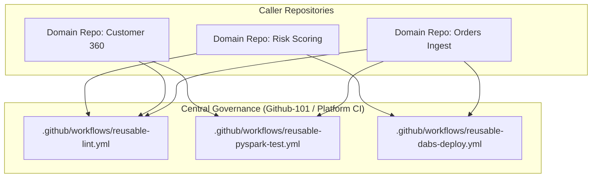

# Reusable Workflows Architecture

Reusable workflows allow engineering teams to define standard CI/CD logic in a centralized location, preventing duplicate YAML files across repositories and enforcing uniform quality gates.

## 1. Motivation
In multi-repository data organizations, duplicating GitHub Actions workflows leads to:
* Configuration drift between domain data pipelines.
* Inconsistent linting and testing standards.
* Security vulnerabilities when secrets or deployment scripts are updated in one repo but missed in others.

## 2. Reusable Workflow Interface Specification

Reusable workflows utilize GitHub Actions `workflow_call` trigger:

```yaml
# .github/workflows/reusable-pyspark-test.yml
name: Reusable PySpark Test Suite

on:
  workflow_call:
    inputs:
      python-version:
        required: false
        type: string
        default: "3.11"
      coverage-threshold:
        required: false
        type: number
        default: 85
    secrets:
      DATABRICKS_HOST:
        required: false
      DATABRICKS_TOKEN:
        required: false

jobs:
  run-tests:
    runs-on: ubuntu-latest
    steps:
      - uses: actions/checkout@v4
      - name: Set up Python
        uses: actions/setup-python@v5
        with:
          python-version: ${{ inputs.python-version }}
      - name: Run PyTest
        run: |
          pip install pytest pytest-cov pyspark
          pytest --cov=src --cov-fail-under=${{ inputs.coverage-threshold }} tests/
```

## 3. Modular Workflow Hierarchy



## 4. Reusable Deployment Workflow for Databricks Bundles

```yaml
# .github/workflows/reusable-dabs-deploy.yml
name: Reusable DABs Deployment

on:
  workflow_call:
    inputs:
      target-environment:
        required: true
        type: string
      databricks-cli-version:
        required: false
        type: string
        default: "0.220.0"

jobs:
  deploy-bundle:
    runs-on: ubuntu-latest
    environment: ${{ inputs.target-environment }}
    steps:
      - uses: actions/checkout@v4
      - name: Install Databricks CLI
        run: |
          curl -fsSL https://raw.githubusercontent.com/databricks/setup-cli/main/install.sh | sh
      - name: Validate Asset Bundle
        run: databricks bundle validate -t ${{ inputs.target-environment }}
      - name: Deploy Asset Bundle
        run: databricks bundle deploy -t ${{ inputs.target-environment }}
```
