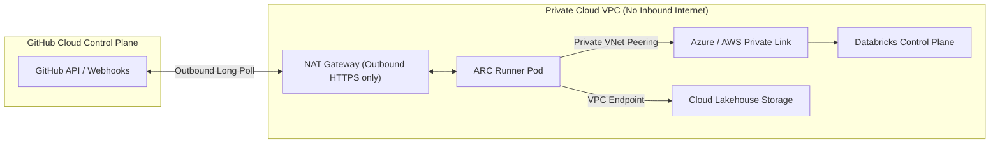

# Self-Hosted Runners Architecture

While GitHub-hosted runners handle standard linting and unit testing, specialized data platform tasks require private network access to internal databases, cloud VPCs, and on-premises storage.

## 1. When to Use Self-Hosted Runners
* **Private Network Egress**: Deploying to Databricks workspaces enclosed in private subnets with no public IP.
* **On-Premise Ingest Validation**: Running integration tests against private Oracle/SQL Server data sources.
* **Cost Optimization for High-Compute CI**: Executing GPU or high-memory data generation benchmarks.

## 2. Infrastructure Architecture: Ephemeral ARC on Kubernetes

We deploy self-hosted runners using GitHub Actions Runner Controller (ARC) on private Kubernetes clusters (EKS / AKS):

```
                        Cloud VPC (Private Subnet)
┌────────────────────────────────────────────────────────────────────────┐
│  Kubernetes Cluster (EKS / AKS)                                        │
│  ┌──────────────────────────────────────────────────────────────────┐  │
│  │ Action Runner Controller (ARC) Operator                          │  │
│  │                                                                  │  │
│  │    Polls GitHub API via outbound HTTPS (Port 443)                │  │
│  │    ┌──────────────────────────┐   ┌──────────────────────────┐   │  │
│  │    │ Runner Pod (Ephemeral)   │   │ Runner Pod (Ephemeral)   │   │  │
│  │    │ - Destroyed after 1 job  │   │ - Destroyed after 1 job  │   │  │
│  │    └─────────────┬────────────┘   └─────────────┬────────────┘   │  │
│  └──────────────────┼──────────────────────────────┼────────────────┘  │
│                     │                              │                   │
│                     ▼                              ▼                   │
│         Databricks Private Link        Internal Data Lake Storage      │
└────────────────────────────────────────────────────────────────────────┘
```

## 3. Network Topology & Security Boundaries



## 4. Runner Hardening & Ephemeral Lifecycle

To eliminate persistence risks across untrusted workloads:
* **Ephemeral Runner Pods**: Every job executes inside a newly scheduled Kubernetes pod. Once the job completes (pass or fail), the pod and its volumes are terminated immediately.
* **Non-Root Execution**: Runner containers run under non-root UID 1000.
* **No Docker-in-Docker (DinD)**: Container builds use rootless build tools (Kaniko / Buildah) to prevent host privilege escalation.
