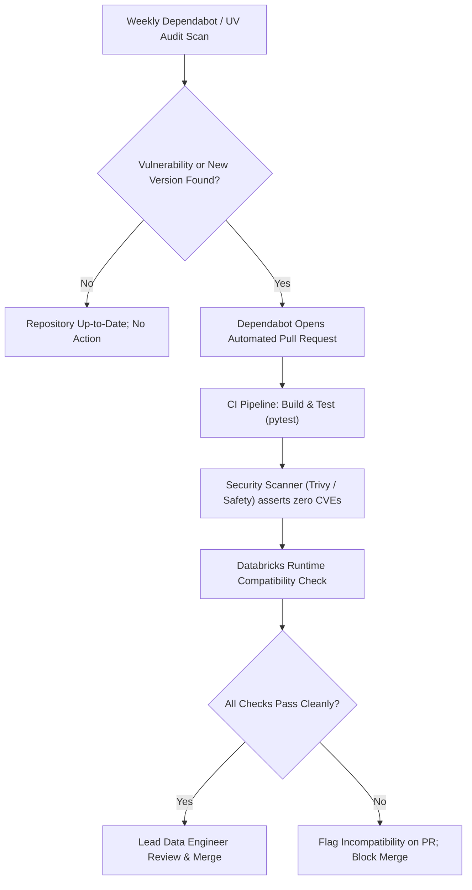

# Dependency Management & Supply Chain Architecture

Managing third-party Python packages across distributed data platforms requires strict lockfiles, cryptographic hash validation, and Databricks Runtime compatibility to guarantee reproducibility and prevent supply chain attacks.

## 1. Guiding Principles
* **Strict Lockfiles**: Every dependency and transitive dependency is pinned to an exact version and SHA-256 hash.
* **Zero Direct `pip install` on Clusters**: Libraries are packaged into wheel artifacts or deployed via Databricks Asset Bundles.
* **Automated Vulnerability Auditing**: Automated PR scans detect outdated or vulnerable packages before merge.

## 2. Lockfile Architecture (`pyproject.toml` & `uv.lock`)

We declare high-level requirements in `pyproject.toml` and generate deterministic lockfiles using `uv`:

```toml
# pyproject.toml
[project]
name = "lead-data-platform"
version = "2.1.0"
dependencies = [
    "pyspark==3.5.0",
    "delta-spark==3.1.0",
    "pydantic>=2.6.0,<3.0.0",
    "requests>=2.31.0,<3.0.0",
]

[project.optional-dependencies]
dev = [
    "pytest>=8.0.0",
    "pytest-cov>=4.1.0",
    "chispa>=0.9.4",
    "dbldatagen>=0.4.0",
    "ruff>=0.3.0",
    "black>=24.2.0",
    "sqlfluff>=3.0.0",
]
```

## 3. Dependency Update & Security Scan Workflow


