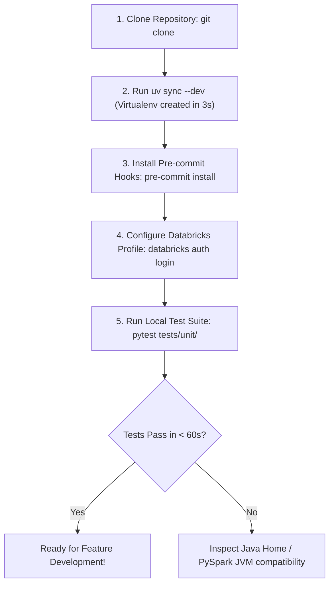

# Local Development Environment Setup Guide

This guide enables data engineers to replicate the continuous integration (CI) pipeline environment locally on their workstations, minimizing feedback loops and onboarding friction.

## 1. Guiding Principles
* **Fast Onboarding**: A newly hired data engineer must be able to run tests within 15 minutes of cloning the repository.
* **Deterministic Tooling**: Standardized Python versions, package managers, and JVM runtimes enforced via configuration files.
* **Hermetic Local Testing**: Ability to run unit tests without requiring active internet access or cloud credentials.

## 2. Core Prerequisites & Tooling Stack

Before configuring the repository, ensure the following core tools are installed:

| Tool | Version | Purpose | Installation Command |
| :--- | :--- | :--- | :--- |
| **Python** | `3.11.x` | Primary programming language | `asdf install python 3.11.9` / `pyenv install 3.11.9` |
| **UV** | `0.4.x+` | Ultra-fast Python package resolver | `curl -LsSf https://astral.sh/uv/install.sh \| sh` |
| **Java (OpenJDK)** | `17 LTS` | Required for local PySpark JVM execution | `brew install openjdk@17` / `apt-get install openjdk-17-jdk` |
| **Databricks CLI** | `0.220.0+` | Asset bundle management and deployment | `curl -fsSL https://raw.githubusercontent.com/databricks/setup-cli/main/install.sh \| sh` |
| **Docker Desktop** | `24.x+` | Containerized integration testing & Devcontainers | Official Docker installer |

## 3. Step-by-Step Local Setup Workflow



### Setup Command Sequence
```bash
# 1. Clone repository
git clone https://github.com/Balasubramanian-pg/Github-101.git
cd Github-101

# 2. Synchronize virtual environment with UV
uv sync --dev

# 3. Activate virtual environment
source .venv/bin/activate  # On Windows: .venv\Scripts\activate

# 4. Install pre-commit hooks
pre-commit install

# 5. Execute unit tests
pytest tests/unit/
```
