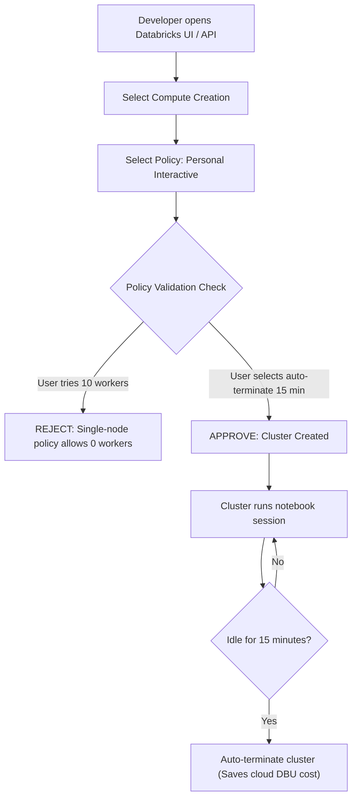

# Cluster Policies Architecture

Cluster policies enforce operational guardrails, cost controls, security requirements, and architectural standards on user-created and automated compute clusters in Databricks.

## 1. Objectives of Cluster Policies
* Prevent developers from inadvertently provisioning massive, high-cost multi-node GPU clusters.
* Enforce automatic termination on all interactive compute.
* Standardize on Long-Term Support (LTS) Databricks Runtimes.
* Mandate cost attribution tags across all clusters.

## 2. Standard Policy Taxonomy

We enforce three core cluster policies across the enterprise:

| Policy Name | Target Workload | Max Nodes | Auto-Termination | Worker Instance Family |
| :--- | :--- | :--- | :--- | :--- |
| **Personal Interactive** | Ad-hoc EDA & notebook testing | Single-Node (0 workers) | **15 minutes** | General purpose (8-16 GB RAM) |
| **Team Collaborative** | Shared departmental development | 4 workers | **30 minutes** | Memory optimized (32 GB RAM) |
| **Automated Batch Job** | Production pipelines & CI/CD | Autoscaling (1-8 nodes) | Immediate on completion | Compute optimized (Photon enabled) |

## 3. Declarative Cluster Policy Definition (JSON Specification)

### Personal Interactive Policy JSON
```json
{
  "autotermination_minutes": {
    "type": "range",
    "minValue": 10,
    "maxValue": 20,
    "defaultValue": 15,
    "isOptional": false
  },
  "spark_version": {
    "type": "regex",
    "pattern": "14\.3\..*-scala2\.12",
    "defaultValue": "14.3.x-scala2.12"
  },
  "num_workers": {
    "type": "fixed",
    "value": 0,
    "hidden": true
  },
  "spark_conf.spark.databricks.cluster.profile": {
    "type": "fixed",
    "value": "singleNode",
    "hidden": true
  },
  "data_security_mode": {
    "type": "fixed",
    "value": "SINGLE_USER"
  }
}
```

## 4. Policy Inheritance & Enforcement Flow



## 5. Policy Governance & CI/CD Validation

### Automated PR Validation
The CI pipeline scans Databricks Asset Bundle definitions (`resources/jobs.yml`) to ensure all declared job clusters explicitly reference an approved policy ID:
```bash
# Validates job configurations enforce approved cluster policies
python scripts/validate_cluster_policies.py
```

### Policy Evolution Cycle
Policies are updated quarterly to retire deprecated Databricks Runtimes and add newer cost-effective instance families (e.g. AWS Graviton4).
