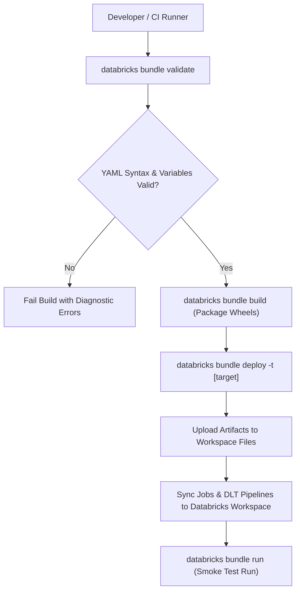

# Databricks Asset Bundles (DABs) Architecture

Databricks Asset Bundles (DABs) provide standard software engineering practices for Databricks projects, enabling declarative configuration, testing, and continuous deployment of data pipelines.

## 1. Why Databricks Asset Bundles?
* Replaces custom shell deployment scripts and legacy `dbx` tooling.
* Native integration with Databricks CLI (`databricks bundle`).
* Declarative YAML resources for Workflows, Delta Live Tables (DLT), and Notebooks.
* Deterministic multi-environment target resolution (`dev`, `staging`, `prod`).

## 2. Bundle Structure & Resource Declaration

```yaml
# databricks.yml
bundle:
  name: order-lakehouse-pipeline

include:
  - resources/*.yml

targets:
  dev:
    mode: development
    default: true
    workspace:
      host: https://adb-dev.azuredatabricks.net
    variables:
      catalog: dev_lakehouse

  prod:
    mode: production
    workspace:
      host: https://adb-prod.azuredatabricks.net
    variables:
      catalog: prod_lakehouse
```

```yaml
# resources/orders_job.yml
resources:
  jobs:
    orders_etl_job:
      name: "[${bundle.target}] Orders Medallion Ingest"
      job_clusters:
        - job_cluster_key: photon_job_cluster
          new_cluster:
            spark_version: 14.3.x-photon-scala2.12
            node_type_id: i3.xlarge
            num_workers: 2
      tasks:
        - task_key: bronze_ingest
          job_cluster_key: photon_job_cluster
          python_wheel_task:
            package_name: lakehouse_orders
            entry_point: ingest_bronze
```

## 3. Bundle Deployment Lifecycle Diagram



## 4. Multi-Environment Target Overrides & Variable Scoping

DABs allow parameterizing environments without code duplication:

```yaml
variables:
  catalog:
    description: "Target Unity Catalog name"
  worker_count:
    description: "Number of compute nodes"
    default: 2

targets:
  dev:
    variables:
      worker_count: 1
  prod:
    variables:
      worker_count: 8
```

In job definitions, variables are referenced via `${var.catalog}` and `${var.worker_count}`, ensuring development clusters remain small and inexpensive while production scales seamlessly.

## 5. Operational Commands & Maintenance

### Daily Developer Commands
* `databricks bundle validate`: Checks schema syntax and variable bindings locally.
* `databricks bundle deploy`: Deploys local bundle state to developer sandbox.
* `databricks bundle run orders_etl_job`: Executes test run on workspace cluster.
* `databricks bundle destroy`: Completely tears down personal sandbox resources.

For emergency pipeline rollback procedures, refer to [Emergency Rollback](../runbooks/emergency-rollback.md).
