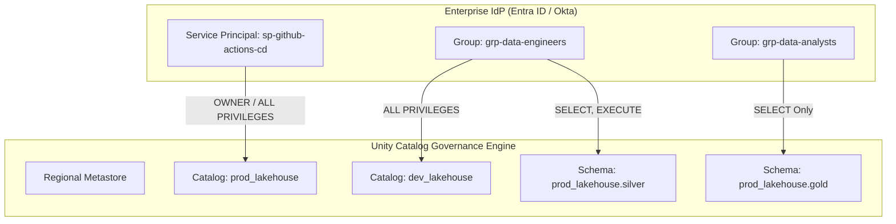

# Identity & Access Management (IAM) in Unity Catalog

Unified data governance requires fine-grained access control across data, metadata, and compute clusters using Unity Catalog.

## 1. Governance Principles
* **Principle of Least Privilege (PoLP)**: Users and service principals receive only the minimal permissions required.
* **Group-Based Access**: Permissions are granted exclusively to Entra ID / Okta directory groups, never to individuals.
* **Decoupled Storage Credentials**: End users never receive direct cloud IAM keys to S3/ADLS storage accounts.

## 2. Unity Catalog Three-Level Namespace & Securable Hierarchy

```text
Metastore (Single per Cloud Region)
└── Catalog (e.g. prod_lakehouse)
    └── Schema (e.g. silver, gold, quarantine)
        ├── Table (e.g. orders, customers)
        ├── View (e.g. v_daily_revenue)
        ├── Volume (e.g. unstructured_landing)
        └── Function (e.g. mask_ssn)
```

### Securable Object Roles
* **Metastore Admin**: Cloud platform team managing top-level catalogs and storage credentials.
* **Catalog Owner**: Domain lead data engineer managing schemas and table creation rights.
* **Data Steward**: Senior engineer managing data quality and column masking policies.
* **Data Analyst / BI**: Read-only access to curated Gold schemas.

## 3. RBAC & Service Principal Architecture Diagram



## 4. Column-Level Masking & Row-Level Filtering

To protect sensitive Personally Identifiable Information (PII) at query time:

### Dynamic Column Masking Function
```sql
CREATE OR REPLACE FUNCTION mask_email(email STRING)
RETURN CASE 
    WHEN is_account_group_member('grp-compliance-officers') THEN email
    ELSE concat(substr(email, 1, 2), '****@', split(email, '@')[1])
END;

-- Apply mask to production table
ALTER TABLE prod_lakehouse.silver.customers 
ALTER COLUMN email SET MASK mask_email;
```

### Row-Level Filter
```sql
CREATE OR REPLACE FUNCTION filter_regional_orders(region STRING)
RETURN is_account_group_member('grp-executives') OR region = current_user_region();

ALTER TABLE prod_lakehouse.gold.orders 
SET ROW FILTER filter_regional_orders ON (order_region);
```

## 5. Audit Logging & Quarterly Access Recertification

All access requests, table queries, and permission grants are streamed directly into Unity Catalog audit tables:

```sql
-- Query who accessed sensitive customer table in past 7 days
SELECT event_time, user_identity.email, action_name, request_params
FROM system.access.audit
WHERE request_params.table_full_name = 'prod_lakehouse.silver.customers'
  AND event_time >= current_timestamp() - INTERVAL 7 DAYS
ORDER BY event_time DESC;
```

### Quarterly Recertification
A compliance job runs quarterly exporting user-to-group mappings. Unused service principals or inactive user accounts are revoked automatically.
