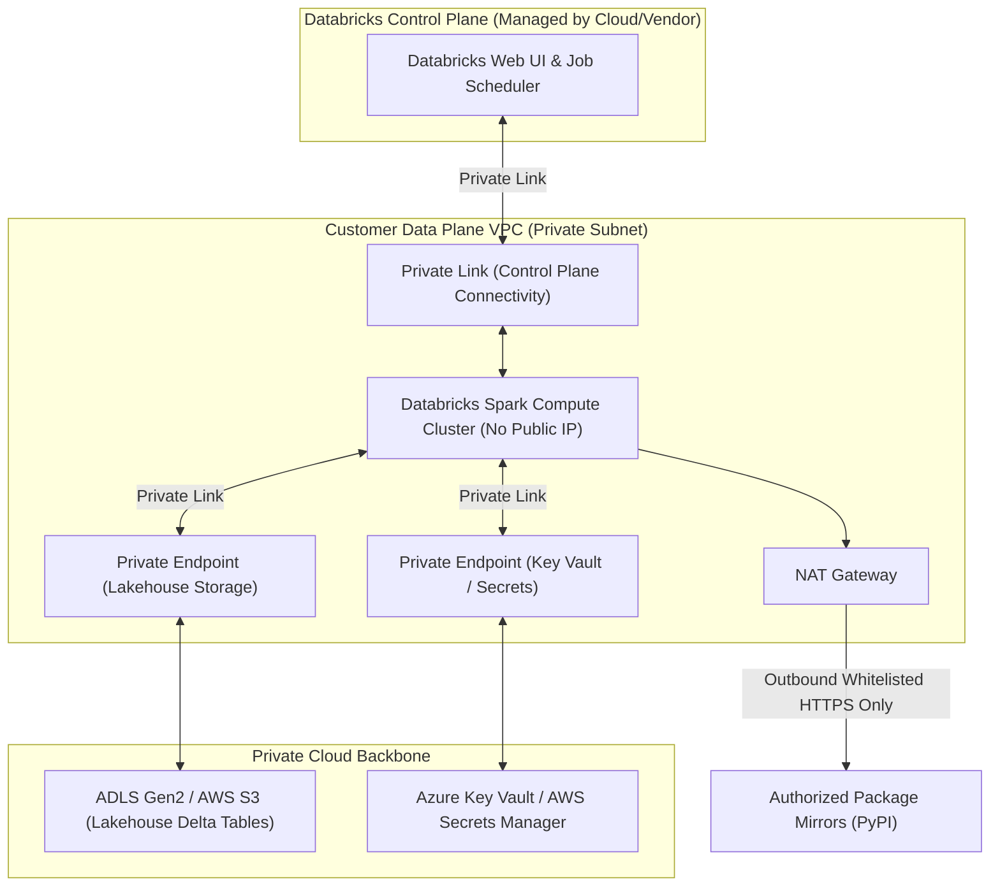

# Network Topology & Private Connectivity

Enterprise data security requires strict network isolation. Our cloud data platform operates inside private Virtual Private Clouds (VPC / VNet) with zero public ingress.

## 1. Guiding Principles
* **Zero Public Ingress**: Compute clusters and storage accounts do not expose public IP addresses.
* **Private Link Everywhere**: Traffic between Databricks control plane, data plane, and cloud storage flows across dedicated cloud backbones.
* **Egress Filtering**: Outbound internet access is restricted through stateful firewalls to authorized package mirrors and webhook endpoints.

## 2. Subnet Architecture & Sizing

The data plane VPC is segmented into three dedicated subnet tiers:

| Subnet Tier | CIDR Block | Purpose | Routing Rules |
| :--- | :--- | :--- | :--- |
| **Public Egress Tier** | `10.100.0.0/24` | NAT Gateways & Application Load Balancers | Routes outbound traffic to Internet Gateway |
| **Compute Host Subnet**| `10.100.16.0/20`| Databricks Spark driver & worker host nodes | No public IP; Routes via Private Endpoints & NAT |
| **Compute Container Subnet**| `10.100.32.0/20`| Databricks Spark internal container networking | Isolated internal communication |
| **Private Endpoint Tier** | `10.100.48.0/24`| Cloud Storage, Key Vault, and Metastore endpoints| Strictly internal Private Link traffic |

## 3. Network Architecture Diagram

## 4. Network Security Group (NSG) Rules

NSGs enforce strict port and protocol restrictions:

### Ingress Rules (Compute Subnet)
* **Rule 100**: Allow inbound from Databricks Control Plane over Private Link on port 443 (Worker management).
* **Rule 200**: Allow intra-cluster communication between workers across ports 1025-65535.
* **Rule 999**: **DENY ALL INBOUND** from public internet (0.0.0.0/0).

### Egress Rules
* **Rule 100**: Allow HTTPS (port 443) to Private Endpoints for Cloud Storage and Key Vault.
* **Rule 200**: Allow outbound HTTPS via NAT Gateway to approved PyPI repositories.
* **Rule 999**: **DENY ALL OTHER EGRESS**.
