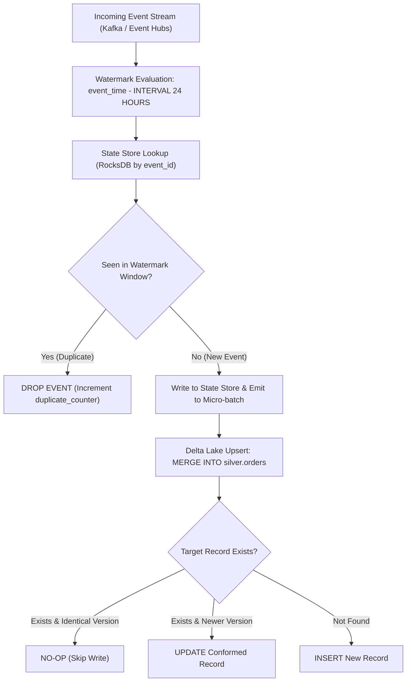

# Event Idempotency & Deduplication Architecture

In distributed event streaming and webhook processing, at-least-once message delivery is standard. The data platform must ensure idempotent execution so processing the same payload multiple times produces identical, duplicate-free state.

## 1. Idempotency Guarantees
* **State Invariance**: Applying an event $N$ times results in the exact same database state as applying it once: $f(f(x)) = f(x)$.
* **Deterministic Primary Keys**: Events without natural unique identifiers have synthetic deterministic keys generated via cryptographic hashing.
* **Zero Duplicate Side Effects**: Billing, notification, or external API side effects are gated by idempotency tokens.

## 2. Deduplication Mechanisms across Lakehouse Layers

We implement deduplication across two strategic boundaries:

| Layer | Technique | Retention Window | Storage Overhead |
| :--- | :--- | :--- | :--- |
| **Bronze Streaming Ingest** | Spark Streaming `dropDuplicates()` with Watermarking | 48-hour event watermark | In-memory state store (RocksDB) |
| **Silver Lakehouse Merge** | Delta Lake `MERGE INTO` with deterministic key matching | Complete table history | Zero runtime state overhead |

## 3. Watermarking & Deduplication Flow Diagram



## 4. PySpark Structured Streaming Deduplication Implementation

```python
from pyspark.sql import DataFrame
import pyspark.sql.functions as F

def process_idempotent_stream(raw_stream_df: DataFrame) -> DataFrame:
    """Deduplicate streaming events within a 24-hour event-time watermark."""
    return (
        raw_stream_df
        .withWatermark("event_timestamp", "24 hours")
        .dropDuplicates(["event_id", "event_timestamp"])
    )

def merge_to_silver(micro_batch_df: DataFrame, batch_id: int):
    """Idempotently merge micro-batch into Delta Lake table."""
    micro_batch_df.createOrReplaceTempView("updates")
    micro_batch_df._jdf.sparkSession().sql("""
        MERGE INTO prod_lakehouse.silver.orders AS target
        USING updates AS source
        ON target.order_id = source.order_id
        WHEN MATCHED AND source.updated_at > target.updated_at THEN
            UPDATE SET *
        WHEN NOT MATCHED THEN
            INSERT *
    """)
```

## 5. Idempotency Verification & Chaos Testing

To verify pipeline idempotency before production deployment:
1. **Replay Testing**: CI integration tests ingest a 10,000-event synthetic batch twice consecutively.
2. **Assertion Check**: Total row count and partition checksums in Silver must be identical between Run 1 and Run 2.
3. If duplicate records leak through, the build fails and alerts the Lead Data Engineer.
