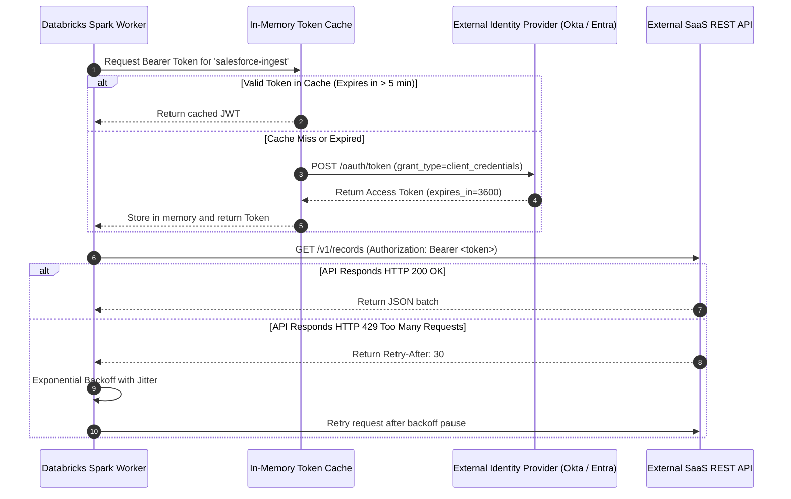

# External API Authentication & Rate Limiting

Data pipelines frequently extract data from or synchronize results with external third-party REST APIs (e.g. Stripe, Salesforce, Workday, ServiceNow). This document specifies authentication protocols, secret management, and rate-limiting resilience.

## 1. Authentication Standards
* **Zero Hardcoded Secrets**: All API tokens, client secrets, and private keys reside in Azure Key Vault / AWS Secrets Manager.
* **OAuth 2.0 Machine-to-Machine (M2M)**: Preferred authentication mechanism using Client Credentials Grant.
* **Token Caching**: Bearer tokens are cached locally in memory until expiration to minimize authentication overhead.

## 2. Authentication Protocol Landscape

| Provider Type | Standard Mechanism | Credential Storage | Refresh Strategy |
| :--- | :--- | :--- | :--- |
| **Enterprise SaaS (Salesforce, Workday)** | OAuth 2.0 Client Credentials | Cloud Key Vault (Client ID + Secret) | Auto-refresh 5 min before JWT expiration |
| **Financial / Payment APIs (Stripe)** | Restricted API Keys | Cloud Key Vault / Databricks Secret Scope | Static with quarterly automated rotation |
| **High-Security Banking Partners** | Mutual TLS (mTLS) + Client Certificate | Azure Key Vault Certificate Store | Annual certificate renewal |

## 3. OAuth2 Token Exchange & Caching Flow Diagram



## 4. Resilient Python API Client with Backoff & Jitter

```python
import time
import random
import requests

class ResilientApiClient:
    def __init__(self, base_url: str, token_provider):
        self.base_url = base_url
        self.token_provider = token_provider
        self.session = requests.Session()

    def get_with_retry(self, endpoint: str, max_retries: int = 5) -> dict:
        url = f"{self.base_url}/{endpoint}"
        retries = 0
        while retries < max_retries:
            token = self.token_provider.get_valid_token()
            headers = {"Authorization": f"Bearer {token}", "Accept": "application/json"}
            response = self.session.get(url, headers=headers, timeout=10)
            
            if response.status_code == 200:
                return response.json()
            elif response.status_code == 429: # Rate Limited
                retry_after = int(response.headers.get("Retry-After", 2 ** retries))
                jitter = random.uniform(0.1, 1.0)
                time.sleep(retry_after + jitter)
                retries += 1
            elif response.status_code >= 500: # Transient Server Error
                time.sleep((2 ** retries) + random.uniform(0.1, 0.5))
                retries += 1
            else:
                response.raise_for_status()
        raise TimeoutError(f"API request failed after {max_retries} retries.")
```

## 5. Security & Log Scrubbing Protocols

### Zero-Logging of Credentials
* HTTP headers containing `Authorization: Bearer ...` or `X-API-Key` are automatically scrubbed by custom logging filters before printing to Spark driver stdout.
* Stack traces thrown by HTTP exceptions are sanitized to redact query parameters and token strings.

### Secret Rotation Integration
When an external API credential is rotated in Azure Key Vault / AWS Secrets Manager, refer to [Secret Rotation Runbook](../security/secret-rotation.md) to ensure zero pipeline downtime.
