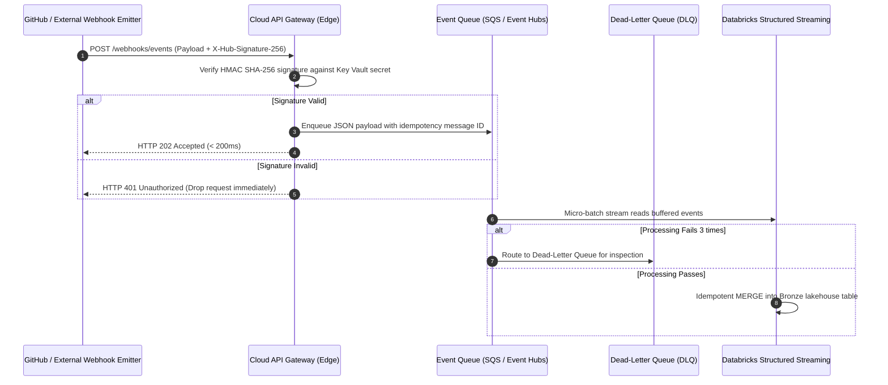

# Webhook Architecture & Event-Driven Automation

Our data platform leverages event-driven webhooks to synchronize version control events, pipeline deployment triggers, and real-time operational notifications with internal lakehouse services.

## 1. Architectural Vision
* **Event-Driven Execution**: Replace polling schedulers with real-time push webhooks for faster pipeline response times.
* **Decoupled Asynchronous Ingestion**: Webhook payloads are received by a lightweight API gateway and buffered in a message queue before reaching Databricks compute.
* **Cryptographic Verification**: Every incoming webhook payload is verified using HMAC SHA-256 signatures before processing.

## 2. Ingestion Pipeline Components

The webhook architecture consists of four distinct components:

1. **Webhook Emitter**: GitHub (release published, push to main, workflow run completed) or upstream SaaS platforms (Stripe, Salesforce).
2. **Edge Ingestion Gateway**: Cloud API Gateway (AWS API Gateway / Azure API Management) verifying SSL/TLS and rate limits.
3. **Buffering Message Queue**: AWS SQS / Azure Event Hubs decoupling ingest velocity from compute availability.
4. **Processing Sink**: Databricks Auto Loader or Spark Structured Streaming reading continuously from the message queue.

## 3. End-to-End Webhook Sequence Diagram



## 4. Cryptographic Signature Verification (Python Implementation)

Incoming webhooks are verified at the gateway using constant-time comparison to prevent timing attacks:

```python
import hmac
import hashlib

def verify_github_webhook(payload_body: bytes, signature_header: str, secret_token: str) -> bool:
    """Validate that the webhook payload was generated by GitHub."""
    if not signature_header or not signature_header.startswith("sha256="):
        return False
    expected_hash = hmac.new(
        key=secret_token.encode("utf-8"),
        msg=payload_body,
        digestmod=hashlib.sha256
    ).hexdigest()
    
    # Use hmac.compare_digest to prevent timing attacks
    return hmac.compare_digest(f"sha256={expected_hash}", signature_header)
```

## 5. Dead-Letter Queues (DLQ) & Alerting Controls

### Dead-Letter Queue Policy
* Events that fail schema parsing or business validation after **3 retry attempts** are routed directly to `dlq-webhook-events`.
* The DLQ retains failed payloads for 14 days with full header metadata.

### Operational Alerting
* CloudWatch / Azure Monitor alarm triggers if `DLQ.ApproximateNumberOfMessagesVisible > 0`.
* On-call engineer follows [Alert Triage Runbook](../runbooks/alert-triage.md) to inspect quarantined payloads and re-drive them once remediated.
