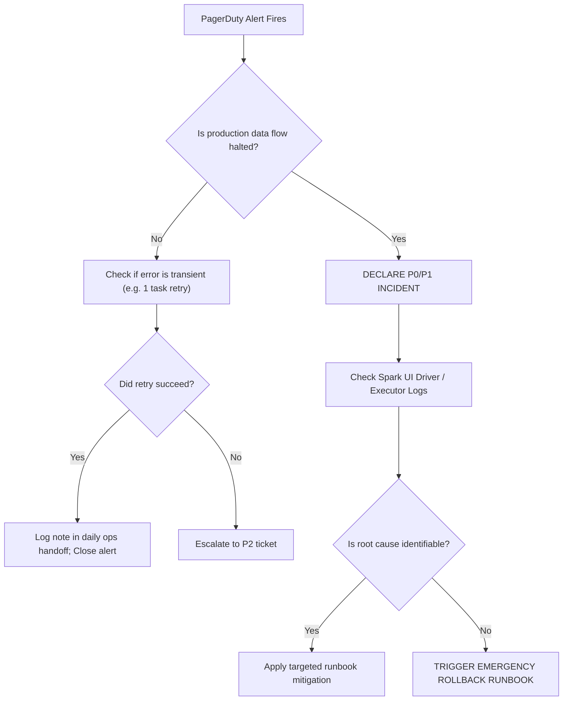

# Runbook: Alert Triage & Diagnostics

This runbook guides on-call engineers through triaging alerts, differentiating actionable failures from transient cloud noise, and diagnosing Spark and Delta Lake runtime errors rapidly.

## 1. Golden Rules of Alert Triage
* **Every Alert Must Be Actionable**: If an alert does not require immediate human intervention, delete or downgrade it.
* **Verify Customer Impact First**: Check downstream BI dashboards and customer APIs before diving into low-level logs.
* **Do Not Restart Blindly**: Always capture diagnostic stack traces before restarting failed clusters.

## 2. Common Data Platform Failures Matrix

| Alert Message | Root Cause | Immediate Action |
| :--- | :--- | :--- |
| **`ConcurrentAppendException`** | Two jobs writing to identical Delta partition concurrently | Verify job schedules; Delta OCC will retry automatically |
| **`SparkException: Job aborted due to stage failure`** | Worker node failure or memory leak | Inspect Spark UI executor tab for Out of Memory (OOM) |
| **`DeltaConcurrentModificationException`** | Conflicting file compaction / update | Check if OPTIMIZE job collided with batch write |
| **`CloudFilesSourceException`** | Corrupt JSON/Parquet file in landing storage | Move file to quarantine storage; unblock stream |

## 3. On-Call Triage Decision Tree



## 4. Diagnostic Runbook Recipes

### Recipe 1: Triaging Out of Memory (OOM)
1. Navigate to Databricks Workspace -> **Compute** -> Target Cluster -> **Spark UI**.
2. Click **Executors** tab. Check for `Exit code 137` (SIGKILL by OS kernel due to container memory limit).
3. If OOM is caused by data skew, inspect SQL query plan for large broadcast joins without broadcast thresholds.

### Recipe 2: Triaging CloudFiles Auto Loader Failures
```python
# Inspect Auto Loader streaming checkpoint state
checkpoint_df = spark.read.format("delta").load("s3://lakehouse-checkpoints/bronze/orders/offsets")
display(checkpoint_df.orderBy(F.col("batchId").desc()).limit(5))
```
