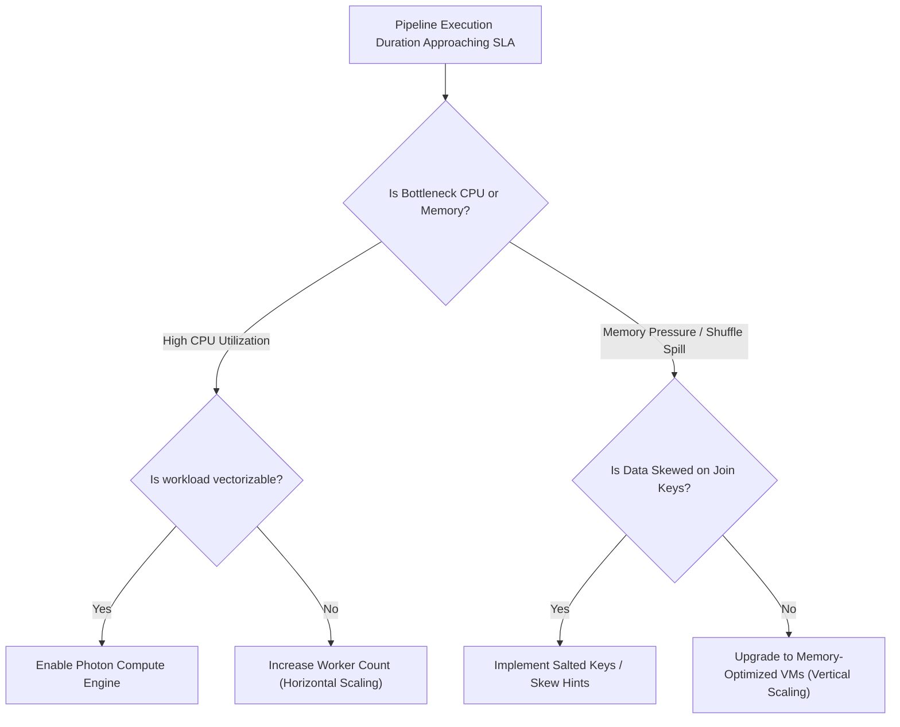

# Runbook: Capacity Planning & Infrastructure Sizing

Capacity planning ensures the data platform proactively accommodates data volume expansion, query throughput growth, and storage lifecycle transitions without unexpected performance degradation or budget overruns.

## 1. Objectives of Capacity Planning
* Forecast compute and storage consumption over 6-month and 12-month horizons.
* Identify compute bottlenecks before they breach production SLAs.
* Transition aging raw data to cold storage to optimize lakehouse economics.

## 2. Growth Forecasting Metrics & Key Indicators

We track four core capacity indicators:

| Indicator | Tracking Source | Warning Threshold | Action Triggered |
| :--- | :--- | :--- | :--- |
| **Daily Ingest Volume** | Cloud Storage metrics | > 20% month-over-month growth | Review worker node autoscaling bounds |
| **Shuffle Spill to Disk** | Spark UI executor metrics | > 10 GB spill per batch | Increase worker memory or repartition keys |
| **Delta Log Size** | `_delta_log` metadata | > 100,000 files in log | Review checkpoint and VACUUM frequencies |
| **Job Duration Drift** | Databricks Job Run telemetry | Duration > 80% of SLA window | Rightsizing cluster or enable Photon |

## 3. Compute Scaling Decision Tree

## 4. Storage Growth Forecasting Formula

Lakehouse storage growth is calculated using:

$$	ext{Projected Storage (TB)} = 	ext{Current Storage} + (	ext{Daily Ingest GB} 	imes 	ext{Days} 	imes 	ext{Compression Factor}) + 	ext{Delta History Overhead}$$

Where:
* **Parquet Compression Factor**: Typically 0.20 - 0.25 (4x-5x compression from raw JSON).
* **Delta History Overhead**: Retaining 7 days of historical versions adds approximately 15% - 25% storage overhead.

## 5. Semi-Annual Capacity Review Checklist

Every 6 months, the Lead Data Engineer conducts an architectural capacity review:
- [ ] Evaluate instance family pricing (Check for newly available AWS Graviton / Azure v5 instances).
- [ ] Audit top 10 most expensive Databricks jobs in `system.billing.usage`.
- [ ] Verify S3 Intelligent-Tiering / Azure Blob lifecycle policies are active on Bronze landing buckets.
- [ ] Present 12-month budget forecast to Engineering Leadership.
