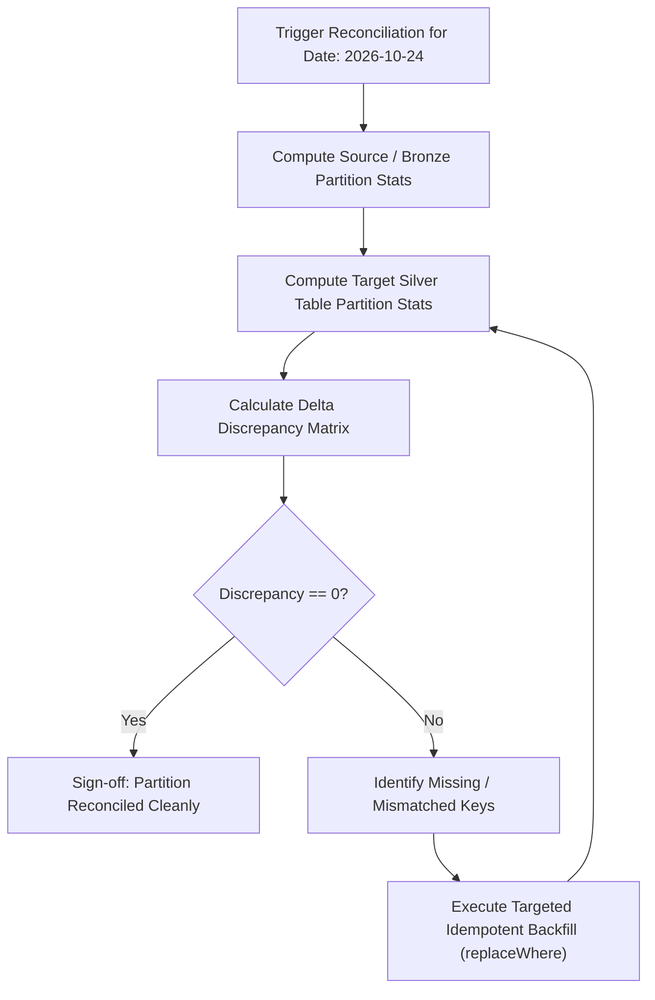

# Runbook: Data Reconciliation & Backfill

Data reconciliation verifies integrity, row-count completeness, and attribute fidelity across pipeline stages following outages, upstream source retries, or emergency rollbacks.

## 1. When to Perform Reconciliation
* Immediately following an [Emergency Rollback](emergency-rollback.md).
* When upstream Kafka / API producers report replayed or duplicate event batches.
* When data quality telemetry indicates a drift breach > 5% in historical partitions.

## 2. Reconciliation Methodologies

We employ three validation techniques:
1. **Row Count & Volume Parity**: Verifying Bronze vs Silver row counts after accounting for filtered quarantine records.
2. **Cryptographic Checksumming**: Hashing conjoined primary keys and critical business values to verify zero mutation.
3. **Aggregated Financial Rollup Comparison**: Recomputing daily revenue metrics in Gold and comparing against source ledger totals.

## 3. Reconciliation Workflow Diagram



## 4. Automated Reconciliation PySpark Script

```python
# scripts/reconciliation_check.py
from pyspark.sql import SparkSession
import pyspark.sql.functions as F

def reconcile_orders_partition(spark: SparkSession, partition_date: str):
    bronze_df = (spark.read.table("prod_lakehouse.bronze.orders")
                 .filter(F.col("order_date") == partition_date))
    silver_df = (spark.read.table("prod_lakehouse.silver.orders")
                 .filter(F.col("order_date") == partition_date))
    quarantine_df = (spark.read.table("prod_lakehouse.quarantine.orders_dq_breach")
                     .filter(F.col("order_date") == partition_date))
    
    bronze_count = bronze_df.count()
    silver_count = silver_df.count()
    quarantine_count = quarantine_df.count()
    
    discrepancy = bronze_count - (silver_count + quarantine_count)
    print(f"Reconciliation for {partition_date}: Discrepancy = {discrepancy}")
    if discrepancy != 0:
        raise ValueError(f"CRITICAL: {discrepancy} records unaccounted for!")
```

## 5. Targeted Partition Backfill Strategy

When discrepancies exist, perform an atomic, idempotent partition replacement using Delta's `replaceWhere` option:

```python
# Atomic partition backfill without touching other days
(reprocessed_silver_df.write
    .format("delta")
    .mode("overwrite")
    .option("replaceWhere", "order_date = '2026-10-24'")
    .saveAsTable("prod_lakehouse.silver.orders"))
```

This guarantees downstream readers never observe partial writes during reconciliation.
