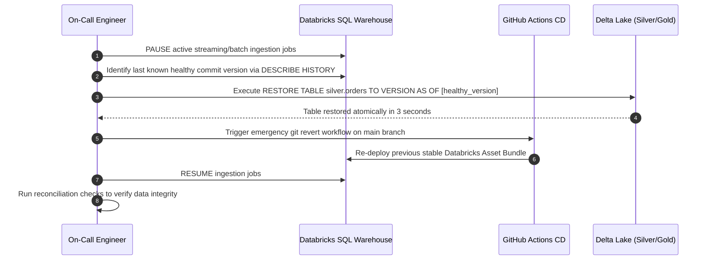

# Runbook: Emergency Rollback & Disaster Recovery

This runbook defines the high-priority operational protocol for reverting pipeline deployments and restoring Delta Lake tables to a known good state following a production incident.

## 1. When to Initiate Emergency Rollback
Rollback is immediately mandatory when:
* A code deployment introduces data corruption or unrecoverable schema drift.
* A critical production pipeline halts and cannot be patched within 15 minutes.
* Business-critical analytical queries or regulatory feeds produce incorrect outputs.

## 2. Two-Tier Rollback Architecture

Emergency rollback requires addressing both **Code State** and **Data State**:

| Tier | Component | Rollback Mechanism | Target Recovery Time (RTO) |
| :--- | :--- | :--- | :--- |
| **Tier 1: Data State** | Delta Lake Storage | SQL `RESTORE TABLE ... TO VERSION AS OF` | **< 5 minutes** |
| **Tier 2: Code State** | Databricks Workflows / DABs | `git revert` + Automated CI Bundle Deploy | **< 10 minutes** |

## 3. Rollback Execution Sequence Diagram



## 4. Concrete Execution Commands

### Step 1: Pause Production Pipeline Jobs
```bash
databricks jobs pause --job-id 847291039482710
```

### Step 2: Restore Delta Table to Healthy Version
```sql
-- Inspect table transaction history
DESCRIBE HISTORY prod_lakehouse.silver.orders;

-- Perform atomic point-in-time restoration
RESTORE TABLE prod_lakehouse.silver.orders TO VERSION AS OF 28;
```

### Step 3: Revert Code in Git & Redeploy
```bash
# Revert offending commit locally or via GitHub UI
git revert HEAD --no-edit
git push origin main
# CD workflow deploys stable bundle automatically
```

## 5. Post-Rollback Data Verification & Incident Review

### Integrity Verification
1. Run [Data Reconciliation Runbook](data-reconciliation.md) across restored partitions.
2. Verify row counts match expectations prior to incident start time.
3. Validate that downstream BI dashboards are showing consistent metrics.

### Incident Review
Initiate blameless incident review within 24 hours in accordance with [Incident Response Runbook](incident-response.md).
