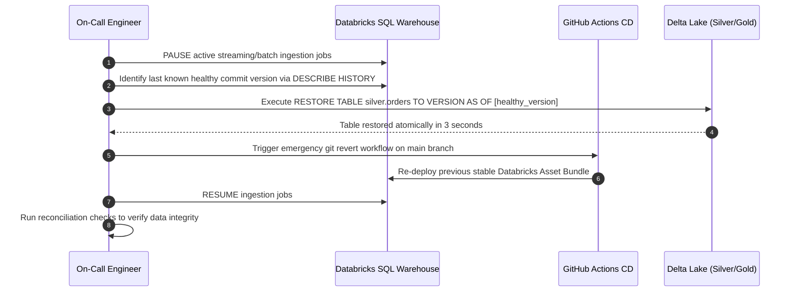

# Runbook: Emergency Rollback & Disaster Recovery

This runbook defines the high-priority operational protocol for reverting pipeline deployments and restoring Delta Lake tables to a known good state following a production incident.

## 1. When to Initiate Emergency Rollback
Rollback is immediately mandatory when:
* A code deployment introduces data corruption or unrecoverable schema drift.
* A critical production pipeline halts and cannot be patched within 15 minutes.
* Business-critical analytical queries or regulatory feeds produce incorrect outputs.

## 2. Two-Tier Rollback Architecture

Emergency rollback requires addressing both **Code State** and **Data State**:

| Tier | Component | Rollback Mechanism | Target Recovery Time (RTO) |
| :--- | :--- | :--- | :--- |
| **Tier 1: Data State** | Delta Lake Storage | SQL `RESTORE TABLE ... TO VERSION AS OF` | **< 5 minutes** |
| **Tier 2: Code State** | Databricks Workflows / DABs | `git revert` + Automated CI Bundle Deploy | **< 10 minutes** |

## 3. Rollback Execution Sequence Diagram

