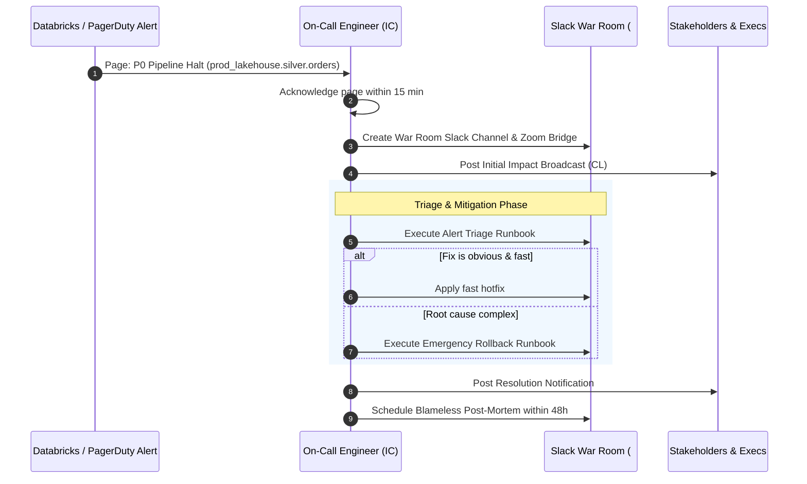

# Runbook: Incident Response & Escalation Protocol

This runbook defines the operational protocol for triaging, communicating, mitigating, and conducting post-incident reviews for production data platform failures.

## 1. Incident Severity Definitions

| Severity | Impact Criteria | Response SLA | Escalation Target |
| :--- | :--- | :--- | :--- |
| **P0 - Blocker** | Production pipelines halted; Gold SLA breached; executive dashboards empty | **< 15 minutes** | VP Engineering, Lead Data Engineer, Platform SRE |
| **P1 - Critical** | Data corruption in partition; delayed downstream reporting; degraded latency | **< 30 minutes** | Lead Data Engineer, Domain Product Owner |
| **P2 - Major** | Pipeline retried successfully; non-critical batch delayed | **< 2 hours** | On-Call Data Engineer |
| **P3 - Minor** | Cosmetic reporting issue; internal log formatting bug | **< 24 hours** | Next sprint triage |

## 2. Incident Command Roles

During a P0/P1 incident, three distinct roles are appointed:
* **Incident Commander (IC)**: Owns the operational response, assigns investigation streams, and makes go/no-go rollback decisions.
* **Technical Lead (TL)**: Drives root-cause debugging, code fixes, and technical mitigation.
* **Communications Lead (CL)**: Posts status updates to stakeholders every 30 minutes and shields engineers from distraction.

## 3. Incident Lifecycle Workflow Diagram



## 4. Communication Templates

### Initial Stakeholder Broadcast (Within 20 minutes)
```text
Title: [INVESTIGATING - P0] Orders Ingest Pipeline Latency Breach
Impact: Orders data in Gold lakehouse delayed by > 60 minutes. Power BI Executive Revenue dashboard showing stale data.
Current Status: Incident response team mobilized. Investigating Spark driver OOM on batch 492.
Next Update: In 30 minutes (14:30 UTC).
Incident Commander: @Balasubramanian-pg
```

### Resolution Broadcast
```text
Title: [RESOLVED - P0] Orders Ingest Pipeline Latency Breach
Summary: Offending batch rolled back and memory allocation increased. Data reconciled with 100% parity.
Root Cause: Upstream order payload spike exceeded driver memory limits.
Follow-up: Full Post-Incident Review will be shared within 48 hours.
```
