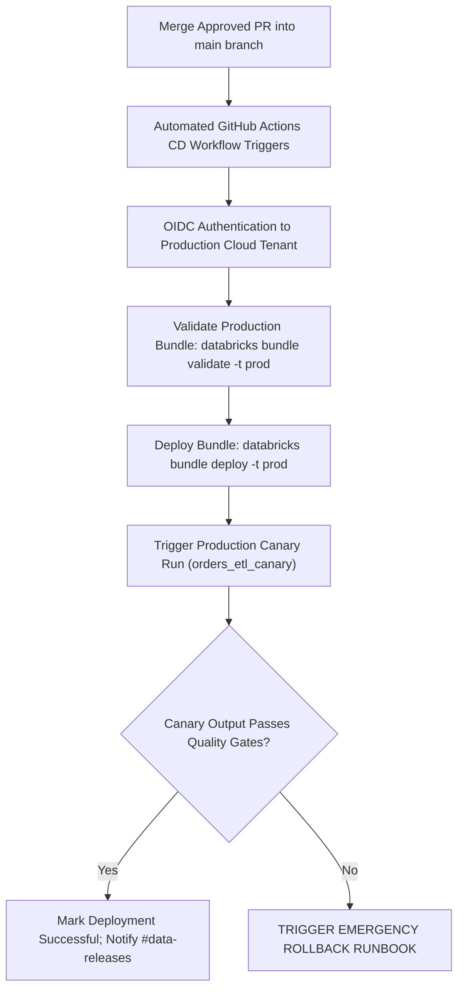

# Runbook: Standard Production Deployment

This runbook outlines the step-by-step operational procedure for deploying code changes, pipeline configurations, and Databricks Asset Bundles to the production lakehouse environment.

## 1. Deployment Windows & Pre-Conditions
* **Approved Release Window**: Tuesday through Thursday, 10:00 - 15:00 UTC. Deployments outside this window require explicit approval from the Engineering Director.
* **Freeze Windows**: Zero production deployments during enterprise quarter-end financial processing or retail peak sale events.
* **Pre-requisite Approvals**: At least two pull request approvals, including at least one designated Lead Data Engineer.

## 2. Pre-Deployment Verification Checklist

Before initiating production deployment:
- [ ] Staging pipeline has run successfully for ≥ 2 consecutive scheduled cycles.
- [ ] No active P0/P1 incidents logged in PagerDuty.
- [ ] Staging data contracts validated with 100% pass rate (`checks/orders_quality.yml`).
- [ ] Rollback commit and target Delta table version identified.
- [ ] Downstream business stakeholders notified in `#data-releases`.

## 3. Deployment Execution Workflow



## 4. Canary Verification & Smoke Testing

Immediately following bundle deployment, the automated CD workflow executes a canary validation job:

```bash
# Execute canary test job in production workspace
databricks bundle run orders_etl_canary -t prod
```

### Verification Checks:
1. **Delta Commit Check**: Verify `_delta_log` commits a new version within 5 minutes.
2. **Row Count Assertion**: Confirm canary batch inserted expected test records without error.
3. **Cluster Health**: Verify job cluster spun up and completed without Spark task retries or shuffle spills.

## 5. Post-Deployment Sign-Off & Rollback Trigger

### Post-Deployment Sign-Off
Once the canary passes and the first scheduled batch completes cleanly:
1. Update deployment ticket status to `Deployed - Verified`.
2. Post confirmation message in `#data-platform-ops` with commit SHA and release tag.

### Rollback Thresholds
If any of the following occur within 60 minutes post-deploy, trigger [Emergency Rollback](emergency-rollback.md) immediately:
* Pipeline task failure with unhandled exception.
* Downstream Gold BI dashboards reporting missing or corrupt records.
* Processing latency exceeding SLA by > 50%.
