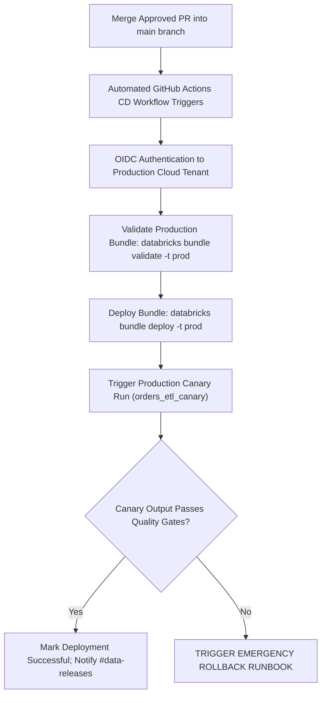

# Runbook: Standard Production Deployment

This runbook outlines the step-by-step operational procedure for deploying code changes, pipeline configurations, and Databricks Asset Bundles to the production lakehouse environment.

## 1. Deployment Windows & Pre-Conditions
* **Approved Release Window**: Tuesday through Thursday, 10:00 - 15:00 UTC. Deployments outside this window require explicit approval from the Engineering Director.
* **Freeze Windows**: Zero production deployments during enterprise quarter-end financial processing or retail peak sale events.
* **Pre-requisite Approvals**: At least two pull request approvals, including at least one designated Lead Data Engineer.

## 2. Pre-Deployment Verification Checklist

Before initiating production deployment:
- [ ] Staging pipeline has run successfully for ≥ 2 consecutive scheduled cycles.
- [ ] No active P0/P1 incidents logged in PagerDuty.
- [ ] Staging data contracts validated with 100% pass rate (`checks/orders_quality.yml`).
- [ ] Rollback commit and target Delta table version identified.
- [ ] Downstream business stakeholders notified in `#data-releases`.

## 3. Deployment Execution Workflow

