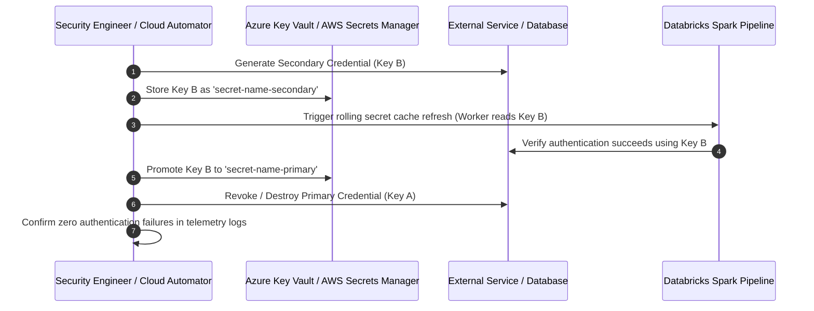

# Runbook: Secret & Credential Rotation Protocol

This runbook establishes standard operating procedures for scheduled and emergency rotation of database passwords, API keys, service principal tokens, and encryption keys across the data platform.

## 1. Guiding Principles
* **Zero Downtime**: Pipelines, streaming jobs, and BI dashboards must continue operating without interruption during secret rotation.
* **Automated Expiration**: All cloud secrets enforce explicit Time-to-Live (TTL) timestamps.
* **Cryptographic Vault Storage**: Secrets are stored exclusively in Azure Key Vault / AWS Secrets Manager.

## 2. Mandatory Rotation Schedules

| Credential Type | Storage Location | Rotation Cadence | Automation Level |
| :--- | :--- | :--- | :--- |
| **Cloud OIDC Federation** | Cloud IAM / STS | Continuous (Hourly TTL) | 100% Automated |
| **Database Service Accounts** | Azure Key Vault / AWS Secrets Manager | **Every 90 days** | Automated via Cloud Function |
| **Third-Party API Tokens (SaaS)**| Databricks Secret Scope | **Every 180 days** | Semi-automated with validation |
| **KMS Customer Managed Keys** | Cloud KMS | **Annually (365 days)** | Automated cloud key rotation |

## 3. Zero-Downtime Dual-Key Rotation Sequence



## 4. Emergency Credential Revocation Protocol

If a secret is inadvertently committed to GitHub or exposed in logs:
1. **Immediate Revocation (< 15 minutes)**:
   * Revoke the compromised credential directly at the provider console or cloud IAM.
2. **Issue Replacement Credential**:
   * Generate new credential and write to Azure Key Vault / AWS Secrets Manager.
3. **Trigger Pipeline Secret Reload**:
   * Restart streaming jobs to flush in-memory worker caches:
   ```bash
   databricks jobs restart --job-id 847291039482710
   ```
4. **Purge Commit History**:
   * If committed to Git, use `git-filter-repo` or BFG Repo-Cleaner to purge the commit and force-push.

## 5. Audit Logging & Verification

Every secret access and rotation event is audited:
```sql
-- Audit secret scope access events in Databricks
SELECT event_time, user_identity.email, request_params.scope, action_name
FROM system.access.audit
WHERE service_name = 'secrets'
  AND event_time >= current_timestamp() - INTERVAL 24 HOURS
ORDER BY event_time DESC;
```

Confirm that the new secret version is being consumed cleanly and log completion in the Enterprise Compliance Register.
