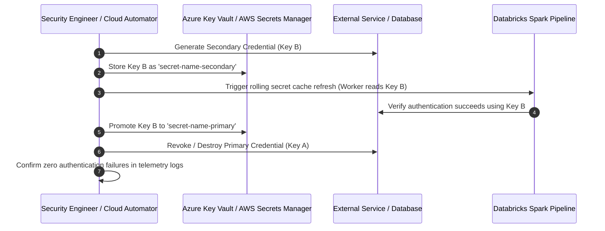

# Runbook: Secret & Credential Rotation Protocol

This runbook establishes standard operating procedures for scheduled and emergency rotation of database passwords, API keys, service principal tokens, and encryption keys across the data platform.

## 1. Guiding Principles
* **Zero Downtime**: Pipelines, streaming jobs, and BI dashboards must continue operating without interruption during secret rotation.
* **Automated Expiration**: All cloud secrets enforce explicit Time-to-Live (TTL) timestamps.
* **Cryptographic Vault Storage**: Secrets are stored exclusively in Azure Key Vault / AWS Secrets Manager.

## 2. Mandatory Rotation Schedules

| Credential Type | Storage Location | Rotation Cadence | Automation Level |
| :--- | :--- | :--- | :--- |
| **Cloud OIDC Federation** | Cloud IAM / STS | Continuous (Hourly TTL) | 100% Automated |
| **Database Service Accounts** | Azure Key Vault / AWS Secrets Manager | **Every 90 days** | Automated via Cloud Function |
| **Third-Party API Tokens (SaaS)**| Databricks Secret Scope | **Every 180 days** | Semi-automated with validation |
| **KMS Customer Managed Keys** | Cloud KMS | **Annually (365 days)** | Automated cloud key rotation |

## 3. Zero-Downtime Dual-Key Rotation Sequence

