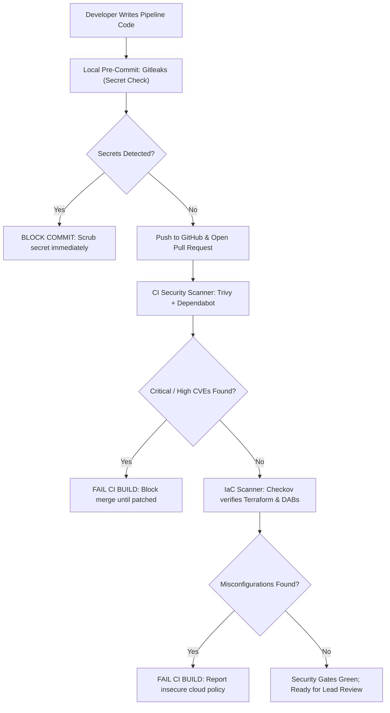

# Vulnerability Scanning & Supply Chain Defense

Data platforms interact with sensitive enterprise information and execute distributed code across cloud infrastructure. Automated vulnerability scanning prevents insecure code, vulnerable dependencies, and misconfigured infrastructure from reaching production.

## 1. Threat Landscape
* **Vulnerable Open-Source Dependencies**: Known CVEs in Python libraries (e.g. remote code execution in deserialization libraries).
* **Hardcoded Credentials & Leaked Secrets**: Cloud access tokens, database passwords, or private keys committed to source control.
* **Infrastructure Misconfigurations**: Publicly readable cloud storage buckets, open security groups, and unencrypted volumes.

## 2. Multi-Layer Vulnerability Scanning Stack

We enforce automated scanning at four distinct defense perimeters:

| Scanning Perimeter | Tooling | Target Assets | Enforcement Point |
| :--- | :--- | :--- | :--- |
| **Secret Detection** | **Trufflehog & Gitleaks** | Git commits, PR diffs, environment files | Pre-commit hook & CI pull request |
| **Dependency CVEs** | **Trivy & Dependabot** | `pyproject.toml`, Python wheels, lockfiles | Automated CI check on every PR |
| **Infrastructure (IaC)** | **Checkov & tfsec** | Terraform files, Databricks Asset Bundles | Pre-merge CI validation gate |
| **Container Images** | **Trivy Container Scan** | Docker images used by self-hosted runners | Container build pipeline |

## 3. Shift-Left Security Pipeline Flow Diagram

