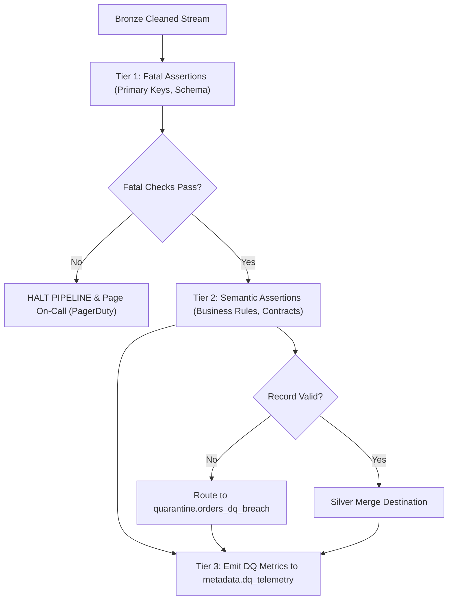

# Data Quality Framework

Data quality is an architectural contract. Incomplete, delayed, or corrupt data must be caught and quarantined at pipeline boundaries before polluting downstream analytical layers.

## 1. Quality Framework Objectives
* **Shift-Left Quality**: Execute assertions during ingestion rather than discovering defects in executive dashboards.
* **Machine-Enforceable Contracts**: Programmatic assertions defined in declarative YAML and tested in CI.
* **Actionable Telemetry**: Centralized quality metrics tracking null rates, distribution shifts, and row volume anomalies.

## 2. Tri-Tier Quality Severity Model

We categorize data quality assertions into three operational tiers:

| Tier | Severity | Action on Breach | Example Assertions |
| :--- | :--- | :--- | :--- |
| **Tier 1: Fatal** | Critical | **Halt pipeline immediately**; quarantine batch; page on-call engineer | Duplicate primary key, NULL foreign key, invalid schema |
| **Tier 2: Warning** | High | **Route records to quarantine**; continue pipeline; post Slack alert | Value outside expected historical range, unusual null percentage |
| **Tier 3: Drift** | Informational | Record metric to telemetry table; trigger automated trend analysis | Row count variance > 15% vs 7-day rolling average |

## 3. Data Quality Gate Architecture



## 4. Implementation with Great Expectations & Soda Core

### Soda Core YAML Specification
```yaml
# checks/orders_quality.yml
checks for silver_orders:
  - row_count > 0
  - missing_count(order_id) = 0
  - duplicate_count(order_id) = 0
  - missing_percent(customer_id) < 0.1%
  - invalid_count(order_status) = 0:
      valid values: ['PENDING', 'CONFIRMED', 'SHIPPED', 'DELIVERED', 'CANCELLED']
  - min(total_amount) >= 0.00
  - max(total_amount) <= 1000000.00
  - freshness(created_at) < 60m
```

### PySpark Great Expectations Runner
```python
from great_expectations.dataset import SparkDFDataset

def validate_dataframe(df):
    ge_df = SparkDFDataset(df)
    res_pk = ge_df.expect_column_values_to_not_be_null("order_id")
    res_unique = ge_df.expect_column_values_to_be_unique("order_id")
    if not (res_pk.success and res_unique.success):
        raise ValueError("Data Quality Fatal Breach: Primary key constraints violated!")
```
