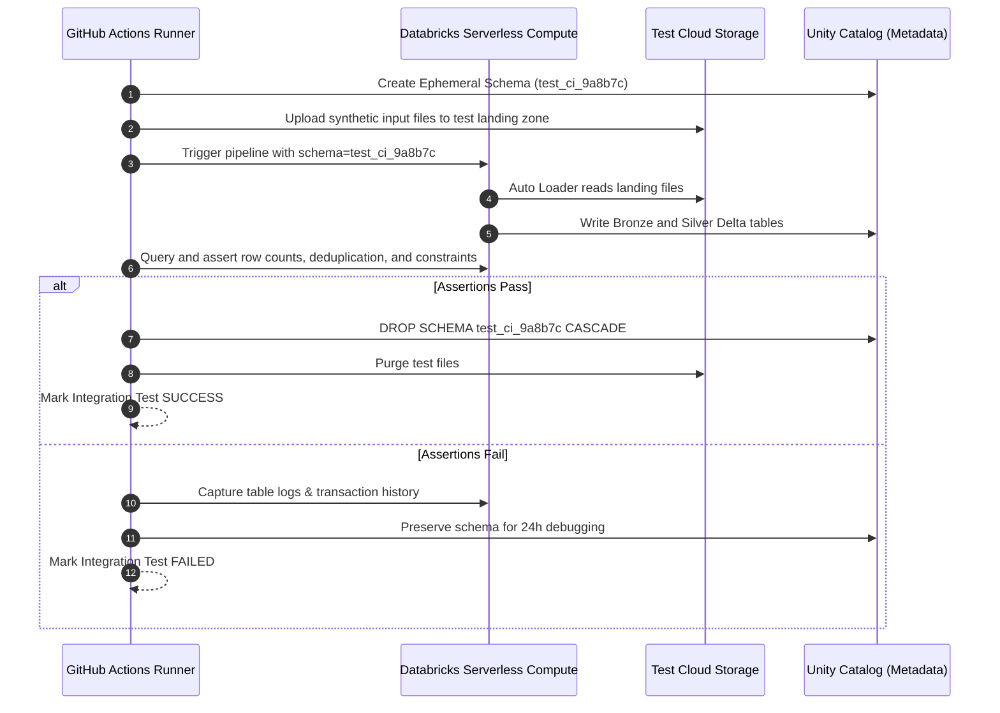

# Integration Testing Architecture

Integration testing validates interactions between the PySpark compute engine, Delta Lake transactional storage, Unity Catalog metadata, and cloud object stores.

## 1. Scope of Integration Testing
While unit tests validate transformation logic in memory, integration tests verify:
* Atomic commits and concurrent writes to Delta Lake tables.
* Auto Loader (`cloudFiles`) ingestion behavior against realistic cloud storage file streams.
* Schema evolution and constraint enforcement in Unity Catalog.
* End-to-end Medallion data flow from Bronze raw landing to Gold dimensional views.

## 2. Ephemeral Sandbox Execution Pattern

Integration tests run against isolated, ephemeral Unity Catalog schemas provisioned dynamically during CI:

```python
# tests/integration/test_pipeline_e2e.py
import uuid
import pytest
from databricks.sdk import WorkspaceClient

@pytest.fixture(scope="module")
def ephemeral_schema(spark):
    schema_name = f"test_ci_{uuid.uuid4().hex[:8]}"
    spark.sql(f"CREATE SCHEMA dev_lakehouse.{schema_name}")
    yield schema_name
    spark.sql(f"DROP SCHEMA dev_lakehouse.{schema_name} CASCADE")
```

## 3. Integration Test Execution Flow Diagram



## 4. Concurrency & ACID Merge Verification

Integration tests validate Delta Lake's ACID properties under concurrent stress:

```python
def test_concurrent_delta_upsert_isolation(spark, ephemeral_schema):
    target_table = f"dev_lakehouse.{ephemeral_schema}.concurrent_orders"
    
    # 1. Initialize base table
    spark.sql(f"CREATE TABLE {target_table} (order_id STRING, amount DOUBLE) USING DELTA")
    
    # 2. Execute concurrent merge transactions
    # Verifies Optimistic Concurrency Control handles retry loops cleanly
    spark.sql(f"""
        MERGE INTO {target_table} AS t
        USING (SELECT '101' as order_id, 99.99 as amount) as s
        ON t.order_id = s.order_id
        WHEN MATCHED THEN UPDATE SET t.amount = s.amount
        WHEN NOT MATCHED THEN INSERT *
    """)
    
    history_df = spark.sql(f"DESCRIBE HISTORY {target_table}")
    assert history_df.count() >= 2
```

## 5. Cost Guardrails & Automated Teardown

To prevent runaway cloud spending during integration testing:
* **Serverless Compute**: Tests use Serverless Compute with auto-pause to eliminate idle cluster costs.
* **Max Cluster Duration**: Any non-serverless test cluster enforces an absolute 30-minute auto-termination policy.
* **Orphan Reaper Cron**: A nightly scheduled workflow sweeps and purges any schemas prefixed with `test_ci_` older than 12 hours.
