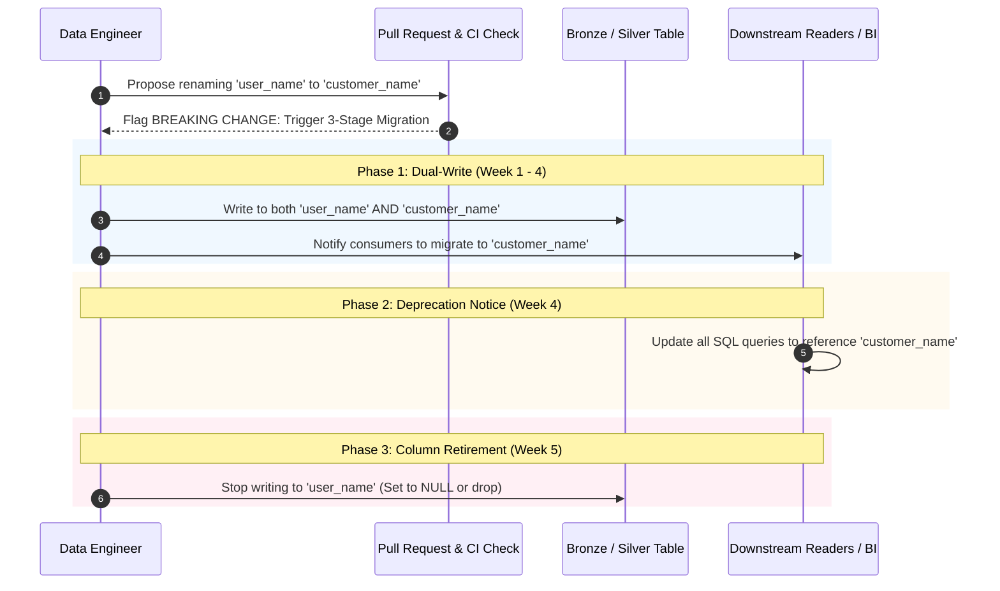

# Schema Evolution & Backward Compatibility

Managing schema changes safely across large-scale distributed datasets is critical. Unplanned schema modifications can break downstream ETL pipelines, reporting dashboards, and machine learning models.

## 1. Guiding Principles
* **Schema Enforcement by Default**: Reject unexpected columns and mismatched data types at ingestion boundaries.
* **Controlled Evolution**: Enable `mergeSchema` exclusively for planned, backward-compatible additions.
* **Zero Breaking Changes Without Notice**: Modifications that break consumers require a 30-day deprecation cycle.

## 2. Schema Change Compatibility Matrix

| Schema Operation | Compatibility Classification | Evolution Strategy | Downstream Impact |
| :--- | :--- | :--- | :--- |
| **Add Nullable Column** | **Backward-Compatible** | Auto-evolve via `mergeSchema` | Safe; consumers ignore new column |
| **Add Non-Nullable Column**| **BREAKING** | Forbidden without default value | Fails inserts without default value |
| **Rename Column** | **BREAKING** | Dual-write pattern with deprecation | Breaks queries referencing old name |
| **Drop Column** | **BREAKING** | 30-day deprecation notice required | Queries referencing column fail |
| **Widen Type (`INT` -> `BIGINT`)** | **Backward-Compatible** | Safe promotion | Downstream readers handle wider type |
| **Narrow Type (`BIGINT` -> `INT`)**| **BREAKING** | Forbidden | Data truncation / runtime exceptions |

## 3. Safe Column Renaming / Deprecation Flow



## 4. Controlled Evolution Implementation in PySpark

To safely ingest additive columns into Delta Lake:

```python
# Controlled schema evolution write configuration
(conformed_df.write
    .format("delta")
    .mode("append")
    .option("mergeSchema", "true")  # Allows additive nullable columns
    .saveAsTable("silver.orders"))
```

### Pre-Merge CI Schema Compatibility Test
A dedicated CI test verifies PR schema compatibility against production schemas:
```python
def test_schema_backward_compatibility(spark):
    prod_schema = spark.read.table("prod_lakehouse.silver.orders").schema
    pr_schema = get_current_pipeline_schema()
    
    # Assert all prod columns exist in PR schema with matching data types
    for field in prod_schema.fields:
        assert field.name in pr_schema.fieldNames(), f"Breaking: Column {field.name} was removed!"
        pr_field = pr_schema[field.name]
        assert pr_field.dataType == field.dataType, f"Breaking: Type changed for {field.name}"
```

## 5. Governance Checklist for Breaking Schema Changes

Before merging any PR flagged with breaking schema modifications:
- [ ] Schema impact analysis completed in `.github/pull_request_template.md`.
- [ ] Downstream consumer stakeholders notified across Slack and email.
- [ ] Unity Catalog column tags updated (`status: deprecated`, `eol_date: 2026-12-01`).
- [ ] Written approval granted by the Lead Platform Architect.
