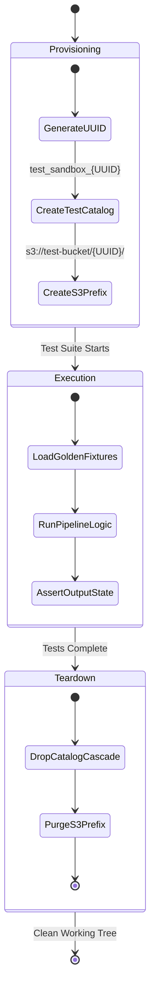

# Test Data Lifecycle & Fixture Management

Managing test data across hundreds of pipeline runs requires strict lifecycle controls, automated cleanup procedures, and clear segregation between golden test baselines and ephemeral run artifacts.

## 1. Principles of Test Data Management
* **Immutability of Golden Fixtures**: Golden reference datasets are read-only and version-controlled.
* **Hermetic Sandbox Isolation**: Each test execution creates an isolated storage prefix and Unity Catalog namespace.
* **Automated Ephemeral Teardown**: Test assets are destroyed immediately following test execution.

## 2. Test Fixture Hierarchy

```text
tests/
├── fixtures/
│   ├── contracts/                    # Schema contract YAMLs
│   │   └── orders_contract_v1.yml
│   ├── golden/                       # Minimal, immutable golden test files
│   │   ├── bronze_orders_sample.parquet
│   │   └── reference_customers.csv
│   └── synthetic/                    # Generation scripts for large fixtures
│       └── generate_performance_suite.py
```

## 3. Ephemeral Sandbox Lifecycle Diagram



## 4. Automated Sandbox Teardown Automation

```python
# tests/helpers/sandbox_manager.py
import uuid
from databricks.sdk import WorkspaceClient

class TestSandbox:
    def __init__(self, w: WorkspaceClient):
        self.w = w
        self.sandbox_id = f"test_{uuid.uuid4().hex[:8]}"
        self.catalog = "dev_lakehouse"
        
    def __enter__(self):
        self.w.schemas.create(name=self.sandbox_id, catalog_name=self.catalog)
        return self.sandbox_id
        
    def __exit__(self, exc_type, exc_val, exc_tb):
        # Always tear down ephemeral schema regardless of test pass or fail
        self.w.schemas.delete(full_name=f"{self.catalog}.{self.sandbox_id}", cascade=True)
```
